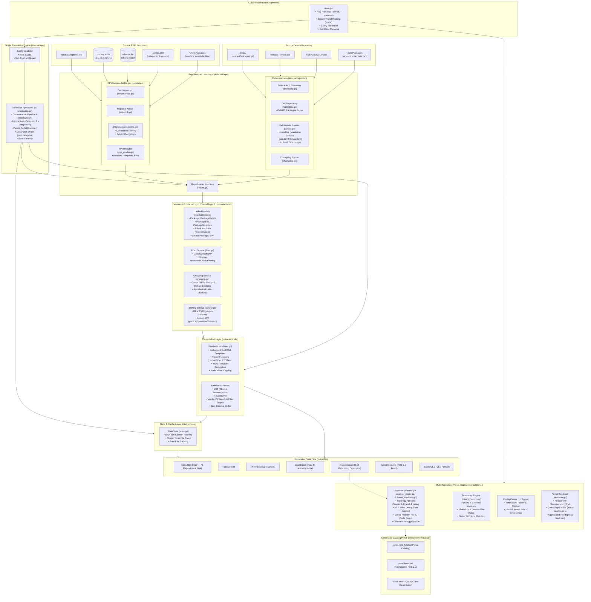
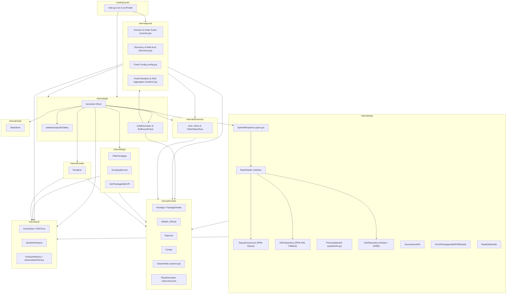
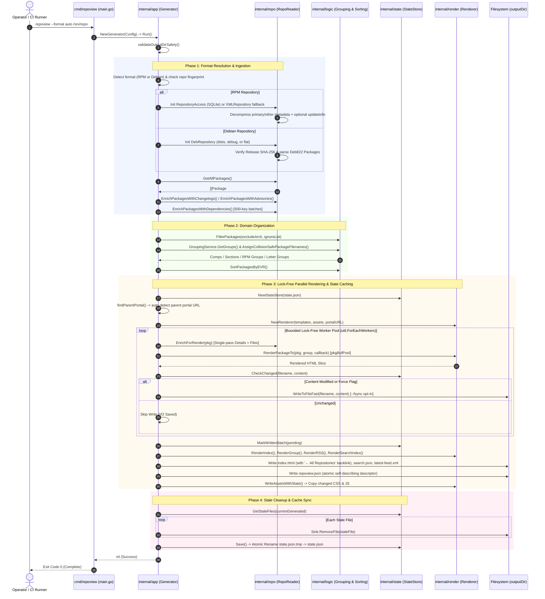
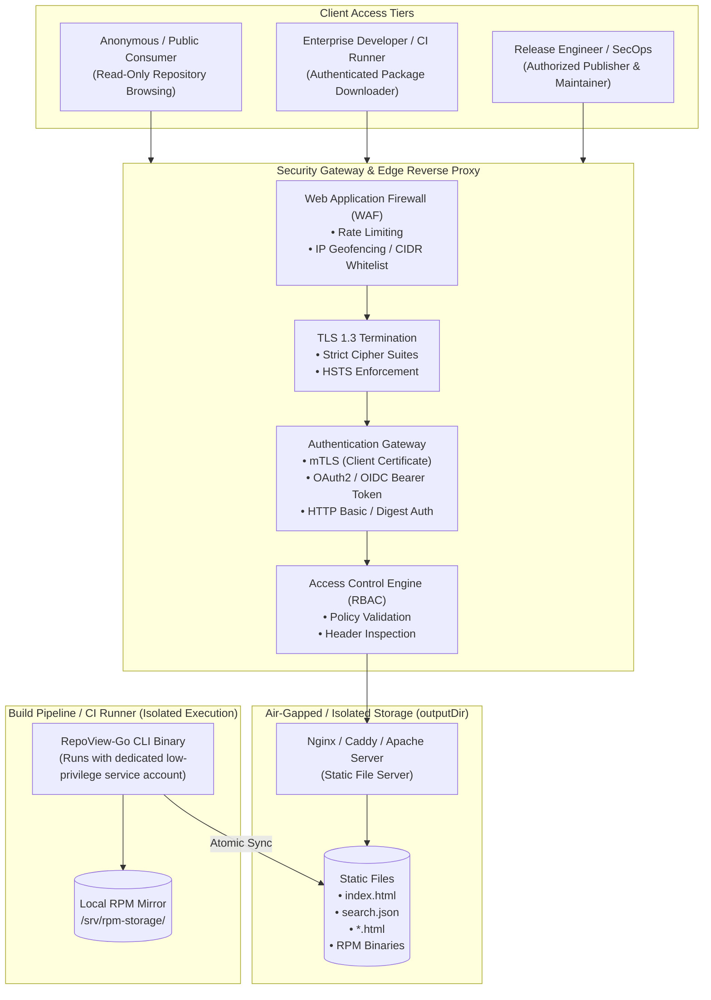

# RepoView-Go System Architecture Document

Architectural specification, technical design choices, concurrency patterns, security model, and component interactions for **RepoView-Go**.

---

## Table of Contents

1. [Architecture and Design Choices](#1-architecture-and-design-choices)
   - [High-Level Architecture Diagram](#high-level-architecture-diagram)
   - [Modular Directory Structure](#modular-directory-structure)
   - [Architectural Design Patterns](#architectural-design-patterns)
   - [Core Design Principles & Paradigms](#core-design-principles--paradigms)
   - [Foundational Assumptions](#foundational-assumptions)
   - [Edge Case Handling](#edge-case-handling)
   - [Performance & Efficiency Engineering](#performance--efficiency-engineering)
2. [Data Flow and Control Logic](#2-data-flow-and-control-logic)
   - [End-to-End Operational Flow](#end-to-end-operational-flow)
   - [Code Relations and Package Interaction](#code-relations-and-package-interaction)
   - [System Sequence Diagrams](#system-sequence-diagrams)
3. [Performance and Scalability](#3-performance-and-scalability)
   - [Concurrency Model & Lock-Free Worker Pool](#concurrency-model--lock-free-worker-pool)
   - [Synchronization & Allocation Primitives](#synchronization--allocation-primitives)
   - [Memory Footprint & Heap Allocation Optimization](#memory-footprint--heap-allocation-optimization)
   - [SQLite Connection Pooling & Prepared Statement Caching](#sqlite-connection-pooling--prepared-statement-caching)
4. [Dependencies](#4-dependencies)
   - [Runtime Modules & External Libraries](#runtime-modules--external-libraries)
   - [Build Tooling & System Dependencies](#build-tooling--system-dependencies)
   - [Package Dependency Diagram](#package-dependency-diagram)
5. [Security Architecture](#5-security-architecture)
   - [Static Site Generation Security Paradigm](#static-site-generation-security-paradigm)
   - [Generator Defenses & Input Sanitization](#generator-defenses--input-sanitization)
   - [Serving Layer Security Architecture](#serving-layer-security-architecture)
   - [Authentication Layers & Supported Methods](#authentication-layers--supported-methods)
   - [Role-Based Access Control (RBAC) Matrix](#role-based-access-control-rbac-matrix)
   - [Security Architecture Diagram](#security-architecture-diagram)

---

## 1. Architecture and Design Choices

RepoView-Go is a high-performance, air-gap compliant static site generator engineered to transform RPM repository metadata (`repodata/`) and Debian repository metadata (`dists/` or flat indices) into a modern, responsive, and easily navigable web portal.

### High-Level Architecture Diagram



### Modular Directory Structure

The application follows a clean, modular architecture separating concerns between data access, domain business logic, state caching, multi-repository cataloging, and presentation:

- **`cmd/repoview`**: Entry point and CLI frontend. Handles long-only argument parsing, flag accumulation, directory validation, subcommand routing (`repoview [repo]` vs. `repoview portal [root]`), and exit code mapping before invoking the orchestration layer.
- **`internal/app`**: Single repository core orchestration layer. `generator.go` orchestrates safety validation, fingerprint short-circuiting, metadata loading, filtering, grouping, sibling discovery, parent portal auto-discovery (`findParentPortal`), lock-free parallel rendering, `repoview.json` emission, and stale cleanup; `repoconfig.go` handles `repoview.yaml` loading and `--dump-config` starter generation/merge.
- **`internal/portal`**: Multi-Repository Auto-Discovery, Taxonomy Classification & Unified Catalog Portal Engine.
  - **`scanner.go` / `scanner_posix.go` / `scanner_windows.go`**: High-speed recursive directory crawler traversing deep hierarchies (`<distro>/<channel>/<arch>`), flat slugs, standalone root repos (`RelPath == "."`), and APT `dists/<suite>/<comp>/debug/binary-<arch>` debug trees (`max_depth` default `7`). Enforces context-aware branch pruning (`pool/`, `SRPMS/`, non-APT `debug/`), cross-platform file-ID cycle protection (POSIX `(dev, ino)` and Win32 volume serial + file index), self-describing metadata detection (`repoview.json`), `.deb`/`.ddeb`/`.rpm` sniffing, and Debian suite aggregation (`AggregateDebianSuites`, isolating `<comp>/debug` cards).
  - **`taxonomy.go`**: Package-local wrappers delegating architecture, distro/channel, slug tokenization, and branding icon matching to `internal/taxonomy`.
  - **`config.go`**: YAML configuration handling for `portal.yaml`, parent directory config discovery climbing, `pinned: true` overrides, and safe non-clobber/merge `--dump-config` generation (`DumpConfigWithOptions`).
  - **`renderer.go`**: Static HTML portal rendering (`portal.html`), deep-linkable URL search/filter synchronization, cross-repo `portal-search.json` generation (`RenderPortalSearchIndex`), and parallel multi-repo RSS feed aggregation (`portal-feed.xml`, Option C).
  - **`types.go`**: Catalog data models and package manager setup snippet builders (`BuildConfigSnippet`).
- **`internal/taxonomy`**: Shared classification ruleset (`taxonomy.go`) for hardware architectures (`DetectPrimaryArch`, `DetectArchFromPath`), custom regex/glob `PathPatternRule` rules, distro/channel heuristics, and branding icons (`MatchDistroIconWithRules`).
- **`internal/repo`**: Data Access Layer (DAL). Unifies package repository access through the `RepoReader` interface and factory entrypoint:
  - **`reader.go` & `open.go`**: Defines `RepoReader` plus optional enricher contracts (`ChangelogEnricher`, `DependencyEnricher`, `PackageRenderEnricher`, `AdvisoryEnricher`) and auto-detecting factory `OpenWithOptions`.
  - **RPM Access (`sqlite.go`, `repomd.go`, `rpm_reader.go`, `rpm_xml.go`, `updateinfo.go`, `comps.go`, `decompress.go`)**: Parses `repomd.xml` (with checksum/size verification), decompresses metadata archives, queries `primary.sqlite`/`other.sqlite` with connection pooling and 500-key batched dependency/changelog queries, falls back cleanly to pure-XML (`primary.xml`/`other.xml`), attaches `updateinfo.xml` CVE errata, and inspects `.rpm` headers in a single pass.
  - **Debian Access (`internal/repo/deb`)**: Discovers `dists/<suite>/<component>/binary-<arch>` layouts, `.ddeb` debug trees, and flat repos (`discovery.go`), verifies `Release`/`InRelease` SHA-256 digests (`release.go`), streams Deb822 `Packages` indexes (`repository.go`), extracts maintainer scripts/conffiles/files/licenses from `control.tar` and `data.tar` (`details.go`), parses `changelog.Debian.gz` (`changelog.go`), and extracts `ar` member timestamps.
- **`internal/logic`**: Domain and Business Logic Layer. Contains:
  - **Grouping**: Organizes packages by Comps categories/groups, RPM header groups with heuristic inference, Debian section taxonomies (`admin`, `devel`, `net`, `web`, etc.), and alphabetical letter buckets.
  - **Sorting**: Implements dual EVR comparison semantics—RPM EVR via `go-rpm-version` and Debian EVR via `pault.ag/go/debian/version`.
  - **Filtering**: Applies glob-based package name/NVRA matching and hardware architecture exclusions (`--ignore-package`, `--exclude-arch`).
- **`internal/render`**: Presentation Layer. `renderer.go` renders HTML5 pages, RSS 2.0 feeds, search indices, and `.repo` / Deb822 `.sources` snippets from `embed.FS` templates; `sink.go` abstracts output persistence via `OutputSink` / `FastOutputSink` and path-contained `AtomicLocalSink`.
- **`internal/state`**: State and Cache Management. Maintains an incremental state store (`state.json`, or `<sha256>.state.json` under `--state-dir`) with SHA-256 content hashing and metadata fingerprinting to avoid redundant disk writes, detect modified pages, and identify stale/orphaned files for pruning.
- **`internal/models`**: Generalized, format-agnostic domain data structures representing repository metadata, packages (`Package`, `PackageDetails`, `PackageFile`, `PackageScriptlets`, `Advisory`), dependencies, comps definitions, search index documents, sentinel errors (`errors.go`), Deb822 adapters (`adapter_deb.go`), and `RepoDescriptor` (`repoview.json`).
- **`internal/util`**: Cross-platform atomic file writes (`atomic.go`), bounded lock-free work-stealing (`concurrent.go`), size-capped multi-format decompression (`decompress.go`), symlink-safe containment checks (`path.go`), POSIX/Windows permission & umask helpers (`perm*.go`, `umask*.go`), formatting (`format.go`), and filename/shell/line sanitization (`sanitize.go`).

- **Lock-Free Worker Stealing & Render Pooling**: Parallel package rendering (`internal/app`) and portal operations use `util.ForEachWorkers` (atomic `atomic.Int64` work stealing), reusable `*bytes.Buffer` pools (`pkgBufPool`), lock-free `rawGenerated[idx]` result slots, and per-worker `StateStore.MarkWrittenBatch`.
- **Single-Pass Archive Inspection & Non-Fsynced Derived Writes**: `PackageRenderEnricher` opens each `latest` (`.rpm`/`.deb`/`.ddeb`) archive at most once for scriptlets, files, and changelogs, while `FastOutputSink.WriteFileFast` skips redundant per-file `fsync()` on replaceable `.html` pages (opt-in via `--fsync`) and reserves strict `fsync` for `state.json`, `index.html`, `repoview.json`, feeds, and search indices.
- **Self-Describing Repository Descriptors**: Every single-repository generation pass writes an atomic `repoview.json` descriptor containing format, package counts, architecture, distros, and relative links, turning leaf directories into zero-overhead nodes for catalog crawlers.
- **Topology-Agnostic Inode Cycle Protection**: Directory scanning in `internal/portal` tracks POSIX `(dev, ino)` tuples across recursive walks to gracefully handle complex nested symlinks and distributed storage mounts without duplicate scans or infinite cycles.
- **Dependency Injection & Struct-Based Configuration**: Components (`Generator`, `RepositoryAccess`, `Renderer`, `StateStore`, `PortalScanner`, `PortalRenderer`) receive explicit configuration structs, eliminating global state and enabling in-process testing without global side effects.
- **Defensive Input Sanitization**: All filenames, group keys, and URL components derived from untrusted package metadata undergo strict whitelist sanitization (`[a-zA-Z0-9._-]`) to neutralize directory traversal and null-byte injection attacks.
- **Two-Phase Atomic File Commit**: State files, portal catalogs, and rendered pages are written to temporary sibling files before being atomically renamed into place, guaranteeing resilience against power failures or abrupt termination.

### Core Design Principles & Paradigms

1. **Static Site Generator (SSG) Paradigm**:
   - Rather than serving dynamic requests through an application server with attached databases, RepoView-Go executes ahead-of-time (AOT) batch generation.
   - The resulting output consists strictly of static HTML5, CSS, JSON, and XML files. This completely eliminates runtime attack surfaces, database connection exhaustion, server-side memory leaks, and dynamic query latency.
2. **Air-Gap Compliance (Zero External Network Calls)**:
   - Enterprise repositories frequently reside in high-security, network-isolated environments (e.g., DoD air-gapped enclaves, offline air-cooled datacenters, VPC private subnets).
   - RepoView-Go bundles 100% of its presentation dependencies (fonts, styles, icons, search scripts) as embedded Go assets (`embed.FS`). Zero external requests to CDN fonts, analytics, or third-party CDNs are emitted.
3. **Multi-Format Repository Architecture (RPM & Debian)**:
   - RepoView-Go decouples presentation and organization from underlying packaging formats through a unified `RepoReader` interface.
   - RPM repositories generated across distinct tooling generations (original `createrepo`, modern `createrepo_c`, or DNF/RHEL) are parsed via SQLite and `repomd.xml`.
   - Debian and Ubuntu repositories are ingested via standard `dists/<suite>/<component>/binary-<arch>` structures or flat layouts, with native support for Deb822 indexes and `ar`/`tar` archive inspection.
4. **State-Driven Incremental Builds**:
   - Repository regeneration avoids redundant disk I/O. The `StateStore` tracks SHA-256 content hashes of all generated artifacts. If package metadata has not changed, write operations are omitted, reducing run times by >90% on subsequent updates.
5. **Multi-Repository Portal & Catalog Architecture**:
   - For enterprise environments hosting hundreds of distinct distribution channels, architectures, and releases, RepoView-Go generates a responsive, glassmorphic catalog (`repoview portal`) aggregating all repositories into a searchable, filterable portal with deep-linking, distribution cards, and unified RSS feed feeds.
6. **Streaming & Bounded Resident Memory**:
   - For repositories containing tens of thousands of packages, eagerly loading all package file lists into memory triggers catastrophic heap growth. File lists are extracted on-demand during parallel package rendering and released immediately via defer-nulling.

### Foundational Assumptions

- **Repository Structure**: The input target must be a readable directory conforming to standard RPM repository conventions (containing `repodata/` with `repomd.xml`) or Debian repository conventions (containing `dists/` with suite metadata or flat `Packages` indices).
- **Filesystem Permissions**: The user executing `repoview` possesses write permissions to `--output-dir` and `--state-dir`.
- **Operating Environment**: Compiled for Linux or Windows (via WSL or CGo-enabled native build) with access to a C compiler for SQLite3 integration.

### Edge Case Handling

| Domain | Edge Case | Mitigation / Implementation |
| :--- | :--- | :--- |
| **Directory Safety** | User passes `--output-dir .` or `--output-dir /` | `validateOutputDirSafety()` aborts before execution if output directory matches repo directory, is an ancestor/parent, is the filesystem root (`/`), or contains existing `repodata/`. |
| **Portal Overwrite Guard** | `repoview portal` pointed at existing directory with foreign `index.html` | Portal generator inspects existing `index.html` for RepoView marker signatures. Aborts execution if non-RepoView file is present unless `--force` is toggled. |
| **Symlink Cycles & Storage Loops** | Circular directory links or complex distributed storage mounts | `scanner_posix.go` records kernel `(dev, ino)` device and inode IDs. Skips already visited inodes to eliminate infinite loops and deduplicate multiple symlinks to identical storage paths. |
| **Branch Noise Pruning** | Large raw storage trees containing `pool/`, `SRPMS/`, `debug/`, or `.git` | `Scanner.isDirExcluded()` prunes multi-gigabyte payload subtrees (`pool/`, `SRPMS/`, `.git`) and unrelated `debug/` directories while sparing APT debug trees inside `dists/<suite>/<comp>/debug/`. |
| **Debian Multi-Component** | Multi-suite or multi-component Debian repositories | `DebRepository` discovers all components in `dists/<suite>`, aggregates package indices, and prioritizes concrete architectures over `all`. In the portal, `AggregateDebianSuites` merges multiple component subtrees into a single logical repository card. |
| **Path Traversal** | Malicious `repomd.xml` contains `<location href="../../etc/passwd"/>` | `ParseRepomd()` cleans all relative paths and enforces strict directory prefix matching against the repo base. |
| **Metadata Corruption** | Truncated `state.json` or unreadable SQLite database | `StateStore` catches JSON parsing errors and automatically falls back to an empty cache state; SQLite queries emit structured domain errors and cleanly rollback. |
| **Compression Formats** | Compressed repodata in Gzip, Zstd, XZ, or Bzip2 | Dynamic header magic sniffing detects algorithm regardless of file extension; stream decompression handles truncated archives gracefully. |
| **Missing Groups / Comps** | Repository lacks group categorization file | `GroupingService` implements format-specific fallbacks: (1) Comps XML or Debian Section taxonomies, (2) Heuristic package name inference, (3) Alphabetical initial letter grouping. |
| **EVR Comparisons** | Tildes (`~`), Carets (`^`), and missing Epochs | `CompareVersions()` / `CompareEVR()` comply with package specifications: RPM EVR via `go-rpm-version` and Debian EVR via `pault.ag/go/debian/version`. Missing epochs default to 0 without allocation. |
| **Debian Build Dates** | Deb822 lacks explicit build timestamp headers | Extracted directly from the numeric modification timestamp inside the outer `ar` archive container header. |
| **Stale Artifacts** | Packages removed from upstream repository | `Generator.cleanupStale()` cross-references previous state store entries with the current execution and unlinks orphaned HTML/JSON files. |

### Performance & Efficiency Engineering

- **Batch Database Processing**: Instead of issuing individual SQLite SELECT queries per package, `EnrichPackagesWithChangelogs` and `EnrichPackagesWithDependencies` query changelogs and all 8 dependency tables using `WHERE pkgKey IN (...)` batches of 500 packages.
- **Lock-Free Work Stealing & Pooled Render Buffers**: Package page rendering distributes work via `util.ForEachWorkers` (`atomic.Int64` cursor), formats pages into pooled `*bytes.Buffer` instances (`pkgBufPool`), writes derived `.html` pages via `AtomicWriteFileFast` (`--fsync` opt-in), and batches `StateStore` commits per worker with compact `state.json` encoding.
- **Parallel Multi-Repository Ingestion**: Portal generation supports concurrent `--render-missing` repository rendering and parallel multi-repo RSS feed aggregation across all detected child repositories.
- **Allocation-Free Hot Paths**: First-letter extraction, EVR epoch parsing, and relation formatting are optimized to minimize string allocations on the Go garbage collector.

---

## 2. Data Flow and Control Logic

### End-to-End Operational Flow

```text
[1. CLI Entrypoint]
  │   Parse long-only flags (--format auto|rpm|deb), load repoview.yaml / portal.yaml, map exit codes 0-8.
  ▼
[2. Safety Guard Validation, Fingerprinting & Format Resolution]
  │   Confirm outputDir safety; short-circuit unchanged repos; detect format (repodata/ vs dists/ or Packages*).
  ▼
[3. Metadata Ingestion via RepoReader]
  │   RPM: Parse repomd.xml -> Decompress primary/other sqlite (or XML fallback) -> Batch changelogs/deps + updateinfo.
  │   DEB: Discover suite/component/debug(.ddeb) -> Verify Release SHA-256 -> Stream Deb822 Packages + ar dates.
  ▼
[4. Categorization & Hierarchy Logic]
  │   RPM: Parse comps.xml / infer RPM groups -> Alphabetical indexing.
  │   DEB: Map Debian sections (admin, devel, net, web, debug, etc.) -> Alphabetical indexing.
  ▼
[5. Lock-Free Parallel Page Rendering (util.ForEachWorkers)]
  │   Workers (clamped 1-16) pull indices atomically -> Single-pass EnrichForRender -> CheckChanged -> AtomicWriteFileFast -> MarkWrittenBatch.
  ▼
[6. Static Asset, Feed & Index Generation]
  │   Render index.html, *.group.html, search.json, latest-feed.xml (universal RSS).
  │   Write self-describing descriptor repoview.json & generate client configuration (.repo / .sources).
  ▼
[7. Stale File Pruning & State Persistence]
      Identify unreferenced previous files -> RemoveFile() -> Atomically save state.json.
```

### Code Relations and Package Interaction



### System Sequence Diagrams

#### 1. Single Repository Generation Flow



#### 2. Multi-Repository Portal & Catalog Flow

```mermaid
sequenceDiagram
    autonumber
    actor Admin as Operator / CI Runner
    participant Main as cmd/repoview (main.go)
    participant Scan as internal/portal (Scanner)
    participant Taxon as internal/taxonomy (Rules & Inference)
    participant App as internal/app (Generator)
    participant PRender as internal/portal (Renderer)
    participant Disk as Filesystem (rootDir / portalHome)

    Admin->>Main: repoview portal --portal-home /srv/portal /srv/repos --render-missing
    Main->>Main: Load or climb portal.yaml (FindPortalConfigIn)
    Main->>Scan: Scanner.Scan() (max_depth=7)
    
    rect rgb(240, 245, 255)
        note over Scan, Taxon: Phase 1: Fast Directory Crawl & File-ID Guards
        Scan->>Scan: Recursive crawl with isDirExcluded (prunes pool/, SRPMS/, spares dists/.../debug)
        Scan->>Scan: Check (dev, ino) / Win32 FileID to eliminate symlink cycles
        Scan->>Disk: Sniff repoview.json (Descriptor Fast-Path)
        alt repoview.json exists
            Scan->>Scan: Ingest RepoDescriptor directly (0-overhead)
        else Un-rendered repo (repodata/ or dists/)
            Scan->>Taxon: InferDistroAndChannelWithRules(), DetectPrimaryArch()
        end
        Scan->>Scan: AggregateDebianSuites() (merge components; isolate debug cards)
        Scan-->>Main: []DiscoveredRepo
    end

    rect rgb(245, 255, 240)
        note over Main, App: Phase 2: On-Demand Parallel Repo Rendering (--render-missing)
        opt If --render-missing or --render-all enabled
            loop util.ForEachConcurrent (1-16 workers)
                Main->>App: NewGenerator(cfg).Run()
                App->>Disk: Render single repository + repoview.json into portalHome
            end
        end
    end

    rect rgb(255, 250, 240)
        note over Main, PRender: Phase 3: Catalog Construction & Aggregation
        Main->>Taxon: BuildCatalog(repos) & ApplyConfig() -> Overrides, Pinned, Snippets
        Main->>PRender: NewRenderer() -> WritePortal()
        PRender->>Disk: Parallel read child latest-feed.xml feeds (util.ForEachConcurrent)
        PRender->>Disk: Render & atomic write portal-feed.xml, portal-search.json, index.html
    end

    Main-->>Admin: Exit Code 0 (Catalog Ready)
```

### Multi-Repository Portal & Catalog Architecture (`internal/portal`)

The multi-repository catalog engine is designed to transform deep, distributed package trees into an enterprise-grade, glassmorphic browsing portal. It is built upon six foundational pillars:

1. **Self-Describing Metadata Contracts (`repoview.json`)**:
   During individual repository generation, `internal/app/generator.go` writes a lightweight, atomic `repoview.json` descriptor file into the root of the output directory (`models.RepoDescriptor`). It encapsulates format (`rpm` or `deb`), package count, detected distribution, channel, architectures, and relative view URLs. The portal crawler reads this JSON file in sub-millisecond time, bypassing expensive SQLite or Deb822 rescanning.

2. **Branch-Pruning Topology-Agnostic Crawler (`scanner.go`)**:
   Repository directories in production take numerous forms: deep hierarchies (`<distro>/<channel>/<arch>`), flat single directories, or dispersed symlinked mount points. The scanner walks directory trees recursively, inspecting directories up to `--max-depth` (default `7`). It employs context-aware branch pruning (`isDirExcluded`) that skips massive package payload directories (`pool/`, `SRPMS/`, `.git`) and unrelated `debug/` directories while sparing APT `.ddeb` debug trees inside `dists/<suite>/<component>/debug/`.

3. **POSIX Inode & Win32 File-ID Cycle Guards (`scanner_posix.go`, `scanner_windows.go`)**:
   To support distributed enterprise storage where multiple repositories or architectures are symlinked across separate mount points, the crawler records platform file identifiers—POSIX `(dev, ino)` or Win32 `(VolumeSerialNumber, FileIndex)`—for every visited directory. This provides mathematical immunity against circular symlinks and prevents duplicate catalog entries for multi-linked directories.

4. **Debian Multi-Component Suite Aggregation (`AggregateDebianSuites`)**:
   Debian repositories frequently feature multiple components (`main`, `contrib`, `non-free`) and multiple architectures under a single `dists/<suite>` tree. Rather than generating fragmented, disconnected cards for every component, `AggregateDebianSuites` groups sibling component trees into a single logical repository card (isolating `<component>/debug` cards), displaying all supported architectures and cumulative package counts.

5. **Heuristic Taxonomy Engine & Icon Mapping (`internal/taxonomy`)**:
   The taxonomy engine automatically infers distribution families (`el8`, `el9`, `el10`, `fedora`, `ubu22`, `ubu24`, `deb11`, `deb12`, `alpine`, `arch`, `suse`, `custom`) and channel classifications (`base`, `custom`, `extras`, `updates`, `security`, `testing`, `stable`) from custom `PathPatternRule` patterns or filesystem path tokens, and matches official SVG distribution branding icons.

6. **Hierarchical Configuration Discovery & Safe Merge (`config.go`)**:
   Portal settings can be customized via `portal.yaml`. If the configuration file is not present in the current execution root, `FindPortalConfigIn` climbs parent directory hierarchies to locate upstream configurations. `--dump-config` emits full metadata and refuses clobbering existing files without `--force`, merging newly discovered repositories safely when `--force` is given.

---

## 3. Performance and Scalability

### Concurrency Model & Lock-Free Worker Pool

The generation bottleneck in large RPM/DEB repositories stems from template execution, disk I/O, and on-demand archive inspection. To saturate CPU cores without channel contention, heap bloat, or mutex serialization, RepoView-Go uses a **Bounded Lock-Free Work-Stealing Pool (`util.ForEachWorkers`)**:

```go
// Clamped worker pool (default min(16, max(1, runtime.NumCPU()*2)), bounded to N items)
util.ForEachWorkers(uniqueNames, g.config.Workers, func(next func() (int, string, bool)) {
    var pending []state.Entry // Worker-local batch accumulator (Zero mutex contention during render)
    for {
        idx, pkgName, ok := next()
        if !ok {
            break
        }
        filename, entry, wrote, err := g.renderSinglePackageWithBatch(db, renderer, stateStore, versions, primaryGroup, pkgName, verbosePkgLog)
        if err != nil {
            atomic.AddInt64(&errorCount, 1)
            continue
        }
        // Pre-allocated index-addressed slice slot (Zero mutex contention)
        rawGenerated[idx] = filename
        if wrote {
            pending = append(pending, entry)
        }
    }
    // Batch commit once per worker at shutdown (reduces mutex locking from O(N) to O(W))
    stateStore.MarkWrittenBatch(pending)
})
```

### Synchronization & Allocation Primitives

1. **Atomic Index Work-Stealing (`util.ForEachWorkers`)**:
   - Replaces per-item channel operations with a shared `atomic.Int64` cursor (`idx := int(nextIdx.Add(1) - 1)`), eliminating channel lock contention across worker goroutines.
2. **Pre-Allocated Output Slots & Pooled Render Buffers (`pkgBufPool`)**:
   - Rendered package filenames are written directly into `rawGenerated[idx]` by index without mutex synchronization.
   - `Renderer.pkgBufPool` (`sync.Pool` of `*bytes.Buffer`, pre-sized to 24 KiB and capped at 512 KiB) recycles HTML rendering buffers across goroutines.
3. **Batched State Tracking (`StateStore.MarkWrittenBatch`) & Compact `state.json`**:
   - Workers compute SHA-256 digests outside the state lock (`CheckChanged`) and commit all changed entries once on worker completion using compact non-indented `state.json` marshaling.
4. **Multi-Repository Concurrent Rendering (`cmd/repoview`)**:
   - When `repoview portal --render-missing` or `--render-all` is executed, target repositories are dispatched concurrently across `util.ForEachConcurrent` (`1–16` clamped workers), each executing an isolated `app.NewGenerator(cfg).Run()`.
5. **Parallel RSS Feed Aggregation & Cross-Repo Search (`internal/portal`)**:
   - `RenderFeed` collects up to 5 latest items per child `latest-feed.xml` concurrently via `util.ForEachConcurrent`, sorts descending by publication date, and caps `portal-feed.xml` at 50 entries.
   - `RenderPortalSearchIndex` compiles child `search.json` rows into compact columnar `portal-search.json` entries for instant cross-repo package/CVE lookup in `portal.html`.
6. **Non-Fsynced Derived Writes (`AtomicWriteFileFast`)**:
   - Replaceable group and package HTML pages use temp-write + rename without per-file `fsync()` by default (`--fsync` opts back in), reserving strict `fsync` (`AtomicWriteFile`) for `state.json`, `index.html`, `repoview.json`, `latest-feed.xml`, `search.json`, `portal-feed.xml`, and `portal-search.json`.

### Memory Footprint & Heap Allocation Optimization

- **Single-Pass On-Demand Archive Inspection (`PackageRenderEnricher`)**:
  In a 10,000-package repository, keeping all file lists in RAM triggers gigabytes of heap growth. RepoView-Go inspects only the newest version's archive (`latest := versions[0]`) once per package via `EnrichForRender` (extracting scriptlets, files, changelogs, and fallback licenses in one open) and immediately clears `latest.Details.Files` after rendering:
  ```go
  if latest.Details != nil {
      defer func() {
          if latest.Details != nil {
              latest.Details.Files = nil // Allow Go GC to reclaim memory immediately
          }
      }()
  }
  ```
- **Batched Database Enrichment & Prepared Statement Caching**:
  `EnrichPackagesWithDependencies` and `EnrichPackagesWithChangelogs` batch `WHERE pkgKey IN (...)` queries across chunks of 500 packages, while single-key prepared statements cover on-demand fallback queries across all 8 RPM dependency tables.

### SQLite Connection Pooling & Prepared Statement Caching

- SQLite is opened in read-only URI mode (`mode=ro&cache=shared&_busy_timeout=5000&_query_only=1`) with `query_only=ON`, `trusted_schema=OFF`, memory temp store, and bounded connection pool sizes (`4–16` connections).
- Prepared statement handles are stored in `RepositoryAccess` and cleanly finalized via `Close()`.

---

## 4. Dependencies

### Runtime Modules & External Libraries

All external dependencies have been audited for reliability, active maintenance, and absence of risky transitivity.

| Module Path | Version | License | Architectural Role |
| :--- | :---: | :---: | :--- |
| **`github.com/mattn/go-sqlite3`** | `v1.14.53` | MIT | CGo SQLite3 driver utilized for low-latency querying of `primary.sqlite` and `other.sqlite`. |
| **`github.com/klauspost/compress`** | `v1.20.5` | BSD-3-Clause | Highly optimized, multi-threaded Zstandard (`zstd`) and accelerated Gzip decompression engine. |
| **`github.com/ulikunitz/xz`** | `v0.5.17` | BSD-3-Clause | Pure Go XZ decompression library handling `.xz` compressed metadata and `.deb` payloads. |
| **`github.com/knqyf263/go-rpm-version`** | Latest | MIT | Upstream-compliant RPM EVR (Epoch-Version-Release) parsing and comparison engine. |
| **`github.com/sassoftware/go-rpmutils`** | `v0.4.0` | Apache-2.0 | RPM payload reader for extracting RPM lead, signatures, scriptlets, and file lists directly from `.rpm` files. |
| **`pault.ag/go/debian`** | `v0.21.4` | MIT | Debian control file, Deb822 index parsing, `.deb` inspection, and Debian EVR version comparison engine. |
| **`go.yaml.in/yaml/v3`** | `v3.0.6` | Apache-2.0 / MIT | YAML configuration parser powering `repoview.yaml`, `portal.yaml` parsing, and `--dump-config`. |

### Build Tooling & System Dependencies

- **Go SDK**: Version `1.26` or higher (`go.mod` specifies `go 1.26.0`).
- **C Compiler**: `gcc` or `clang` required by CGo for `go-sqlite3`. On Alpine Linux, `musl-dev` is required.
- **Operating Systems**: Native Linux (CentOS/RHEL, Debian/Ubuntu, Alpine, Fedora), macOS, and Windows (via WSL or MinGW-w64).

### Package Dependency Diagram

```mermaid
graph TD
    subgraph RepoView["RepoView-Go Modules"]
        CMD["github.com/edsilegxrepo/repoview/cmd/repoview"]
        APP["github.com/edsilegxrepo/repoview/internal/app"]
        PORTAL["github.com/edsilegxrepo/repoview/internal/portal"]
        REPO["github.com/edsilegxrepo/repoview/internal/repo"]
        REPO_DEB["github.com/edsilegxrepo/repoview/internal/repo/deb"]
        LOGIC["github.com/edsilegxrepo/repoview/internal/logic"]
        MODELS["github.com/edsilegxrepo/repoview/internal/models"]
        RENDER["github.com/edsilegxrepo/repoview/internal/render"]
        STATE["github.com/edsilegxrepo/repoview/internal/state"]
        TAX["github.com/edsilegxrepo/repoview/internal/taxonomy"]
        UTIL["github.com/edsilegxrepo/repoview/internal/util"]
    end

    subgraph ThirdParty["Third-Party Dependencies"]
        SQLITE3["github.com/mattn/go-sqlite3"]
        COMPRESS["github.com/klauspost/compress\n(zstd / gzip)"]
        XZ["github.com/ulikunitz/xz"]
        RPM_VER["github.com/knqyf263/go-rpm-version"]
        RPM_UTILS["github.com/sassoftware/go-rpmutils"]
        DEB_MOD["pault.ag/go/debian"]
        YAML_LIB["go.yaml.in/yaml/v3"]
    end

    CMD --> APP
    CMD --> PORTAL
    PORTAL --> YAML_LIB
    PORTAL --> MODELS
    PORTAL --> TAX
    PORTAL --> UTIL
    APP --> YAML_LIB
    APP --> TAX
    APP --> REPO
    REPO --> REPO_DEB
    APP --> LOGIC
    APP --> RENDER
    APP --> STATE
    APP --> UTIL

    REPO --> SQLITE3
    REPO --> COMPRESS
    REPO --> XZ
    REPO --> RPM_UTILS
    REPO_DEB --> DEB_MOD

    MODELS --> DEB_MOD
    LOGIC --> RPM_VER
    LOGIC --> DEB_MOD
```



---

## 5. Security Architecture

### Static Site Generation Security Paradigm

The foundational security strength of RepoView-Go lies in its **AOT Static Architecture**:

```text
Dynamic Application (Traditional Web App)
  [Browser] ---> [Internet] ---> [Web Server] ---> [App Runtime (PHP/Python/Go)] ---> [Database Server]
                                                            ▲
                                           Target for SQLi, RCE, SSRF, Deserialization

RepoView-Go Architecture
  [Build Pipeline] ---> [repoview CLI] ---> [Static Files on Disk]
                                                   │
  [Browser]       ---> [Reverse Proxy / CDN] ──────┘ (Zero server-side code execution)
```

1. **Immunity to Injection Attacks**: Because the serving layer serves purely static HTML, CSS, and JSON files, there are no server-side SQL queries, LDAP searches, or shell commands executed during client browsing.
2. **Zero Remote Code Execution (RCE) Surface**: The public-facing endpoint has no application runtime, eliminating JVM/Python/Node/PHP memory corruption and deserialization exploits.
3. **DDoS Resilience**: Static assets can be cached at line-rate by Nginx, Cloudflare, AWS CloudFront, or local edge proxies without backend database exhaustion.

### Generator Defenses & Input Sanitization

During the generation phase, the `repoview` binary treats all input repository files as potentially untrusted:

- **Path Traversal Shield**: `util.ResolveContainedPath()` and `ParseRepomd()` ensure symlink targets and XML `<location href="...">` paths cannot escape the designated repository root (rejecting traversal payloads such as `../../etc/shadow`).
- **SQLite Read-Only & Schema Hardening (`go-sqlite3` CGo)**: RepoView-Go intentionally uses `github.com/mattn/go-sqlite3` (requiring CGo, reflected by `"cgo": true` in `build.json`) for native SQLite C performance over pure-Go alternatives. Untrusted repository SQLite files are opened via escaped `file:` URIs (`mode=ro`, `_query_only=1`), read-only attached `other.sqlite`, and strict pragmas (`PRAGMA query_only = ON`, `PRAGMA trusted_schema = OFF`, read-only `temp_store`/`cache_size`/`mmap_size`).
- **Filename Sanitization**: `util.SanitizeFilename()` converts arbitrary package identifiers and group names into strictly safe filesystem characters (`[a-zA-Z0-9._-]`), neutralizing directory traversal and null-byte injection (`\x00`).
- **Destructive Deletion Barrier**: `validateOutputDirSafety()` validates that the destination directory is not identical to the repo directory, parent tree, or root partition, preventing accidental data loss when `--force` is toggled.

### Serving Layer Security Architecture

When deployed into production, static repository views are published behind an authenticated reverse proxy or object storage gateway.



### Authentication Layers & Supported Methods

RepoView-Go repositories support four primary enterprise authentication patterns implemented at the reverse proxy layer (e.g. Nginx, Envoy, Caddy):

1. **Mutual TLS (mTLS / Client Certificates)**:
   - **Use Case**: High-security air-gapped defense networks and zero-trust infrastructure.
   - **Mechanism**: The reverse proxy validates the client's X.509 certificate against an internal corporate Certificate Authority (CA) before granting access.
2. **OAuth2 / OpenID Connect (OIDC) Proxy**:
   - **Use Case**: Corporate SSO integration (Okta, Keycloak, Ping, Azure AD).
   - **Mechanism**: Upstream proxy (e.g., `oauth2-proxy`) intercepts requests and validates Bearer JWT tokens.
3. **HTTP Basic / Digest Authentication**:
   - **Use Case**: Native compatibility with standard package managers (`dnf`, `yum`, `zypper`).
   - **Mechanism**: DNF natively passes credentials configured in `/etc/yum.repos.d/*.repo` via `username=` and `password=` fields.
4. **Network-Level CIDR / IP Whitelisting**:
   - **Use Case**: Production datacenter clusters and internal build farm VPCs.
   - **Mechanism**: Access restricted strictly to known internal subnet ranges.

### Role-Based Access Control (RBAC) Matrix

| Principal / Role | Permissions | Accessible Resources | Enforcement Mechanism |
| :--- | :--- | :--- | :--- |
| **Anonymous Consumer** | Read-Only | Public index, group listings, search metadata (`search.json`), RSS feeds | Reverse proxy allows `GET /`, `GET /*.html`, `GET /search.json` without challenge. |
| **Licensed / Internal Developer** | Read-Only (Full) | All HTML pages, search indices, and downloadable `.rpm` package binaries | Reverse proxy enforces HTTP Basic or OIDC session cookie; restricts download endpoints. |
| **Automated CI/CD Worker** | Read-Only (Automated) | DNF repository metadata (`repodata/`) and dependency RPMs | mTLS machine certificate or static API token in `Authorization` header. |
| **Release Engineer / Publisher** | Write / Execute | CLI binary execution, file generation, `state.json` management, stale cleanup | Linux filesystem POSIX permissions (`chmod 0750`, dedicated `repoview` system group). |
| **System Administrator** | Admin / Configuration | Reverse proxy configuration, TLS certificates, cron/systemd service units | OS root / sudo access, infrastructure-as-code management. |

### Content Security Policy (CSP) & Client-Side Hardening

Because RepoView-Go requires zero external network calls, servers hosting the generated site can enforce the strictest Content Security Policy headers:

```http
Content-Security-Policy: default-src 'self'; script-src 'self'; style-src 'self'; img-src 'self' data:; object-src 'none'; frame-ancestors 'none';
X-Content-Type-Options: nosniff
X-Frame-Options: DENY
Referrer-Policy: strict-origin-when-cross-origin
```

- **`default-src 'self'`**: Prevents injection of third-party scripts, remote images, or tracking beacons.
- **`object-src 'none'`**: Completely blocks legacy plugins (Flash, Java Applets).
- **`X-Content-Type-Options: nosniff`**: Prevents MIME-type confusion attacks on static assets.
