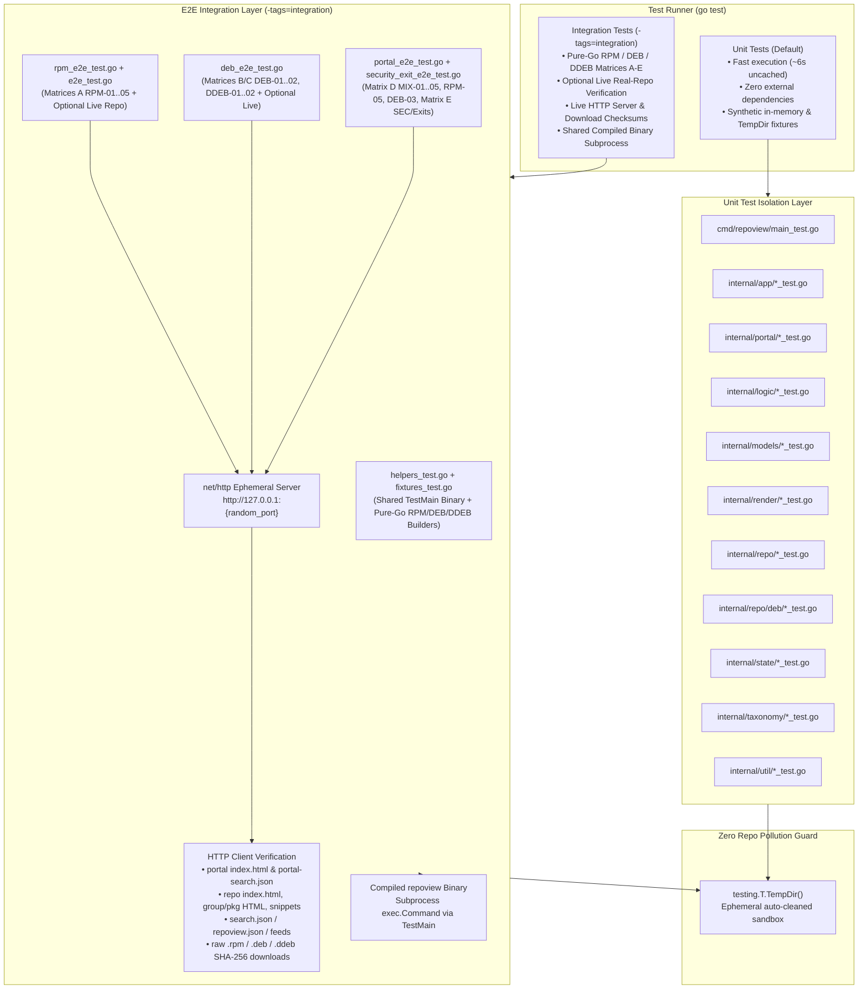
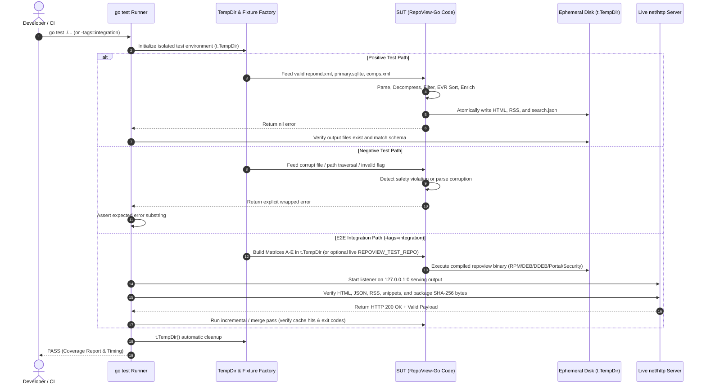

# RepoView-Go Test Suite Documentation

Comprehensive guide to the architecture, design principles, test execution, coverage benchmarks, and verification workflows for **RepoView-Go**.

---

## Table of Contents

1. [Architecture, Design and Principles](#1-architecture-design-and-principles)
   - [Architectural Flow Chart](#architectural-flow-chart)
   - [Core Testing Principles](#core-testing-principles)
2. [Logic Flow of the Tests](#2-logic-flow-of-the-tests)
   - [Logical Sequence Chart](#logical-sequence-chart)
   - [Positive vs. Negative Testing Matrix](#positive-vs-negative-testing-matrix)
3. [Technical Requirements and Setup](#3-technical-requirements-and-setup)
   - [Prerequisites & Dependencies](#prerequisites--dependencies)
   - [Environment Variables](#environment-variables)
   - [Build Constraints & Tags](#build-constraints--tags)
   - [Cross-Platform Portability (Linux & Windows/WSL)](#cross-platform-portability-linux--windowswsl)
4. [Test Package Tree Structure](#4-test-package-tree-structure)
5. [List of Tests](#5-list-of-tests)
   - [CLI & Flag Parsing (`cmd/repoview`)](#cli--flag-parsing-cmdrepoview)
   - [Application Pipeline & Safety (`internal/app`)](#application-pipeline--safety-internalapp)
   - [Business Logic, Filtering & Grouping (`internal/logic`)](#business-logic-filtering--grouping-internallogic)
   - [Domain Models & XML (`internal/models`)](#domain-models--xml-internalmodels)
   - [Template Rendering & Assets (`internal/render`)](#template-rendering--assets-internalrender)
   - [Repository Parsers, Decompression & SQLite (`internal/repo`)](#repository-parsers-decompression--sqlite-internalrepo)
   - [Debian Ingestion & Introspection (`internal/repo/deb`)](#debian-ingestion--introspection-internalrepodeb)
   - [Multi-Repository Portal Engine (`internal/portal`)](#multi-repository-portal-engine-internalportal)
   - [Cache State Management & Concurrency (`internal/state`)](#cache-state-management--concurrency-internalstate)
   - [Shared Taxonomy Rules (`internal/taxonomy`)](#shared-taxonomy-rules-internaltaxonomy)
   - [Formatting, Concurrency & Sanitization Utilities (`internal/util`)](#formatting-concurrency--sanitization-utilities-internalutil)
   - [End-to-End Integration Suite (`tests/integration`, `-tags=integration`)](#end-to-end-integration-suite-testsintegration--tagsintegration)
6. [Code Coverage Report](#6-code-coverage-report)
   - [Current Coverage Statistics](#current-coverage-statistics)
   - [How to Measure and Refresh Statistics](#how-to-measure-and-refresh-statistics)
7. [Realistic Data Simulation](#7-realistic-data-simulation)
   - [Pure-Go Synthetic Fixture Builders (`tests/integration/fixtures_test.go`)](#pure-go-synthetic-fixture-builders-testsintegrationfixtures_testgo)
   - [Optional Live Mirror Verification](#optional-live-mirror-verification)
   - [Ephemeral HTTP Server & Client Verification (`tests/integration/helpers_test.go`)](#ephemeral-http-server--client-verification-testsintegrationhelpers_testgo)
   - [Shared Subprocess Binary Execution (`TestMain`)](#shared-subprocess-binary-execution-testmain)
8. [How to Run the Tests](#8-how-to-run-the-tests)
   - [Bash (Linux / macOS / WSL)](#bash-linux--macos--wsl)
   - [PowerShell (Native Windows & WSL Linux)](#powershell-native-windows--wsl-linux)
9. [Maintenance and Troubleshooting](#9-maintenance-and-troubleshooting)

---

## 1. Architecture, Design and Principles

RepoView-Go employs a multi-tiered testing strategy structured to detect deep architectural regressions, concurrency hazards, memory leaks, malicious inputs, and real-world repodata inconsistencies.

### Architectural Flow Chart



### Core Testing Principles

1. **Defect Discovery Over Convenience**: Tests are deliberately written to uncover hard-to-find defects, boundary edge cases, format variations (e.g., XML element vs. attribute revisions in `repomd.xml`), path traversals, and corrupt payload recovery. Tests never bypass or mask genuine code flaws.
2. **Strict Zero Repository Pollution**: Every test generating disk artifacts MUST allocate directories exclusively via `t.TempDir()`. No test leaves behind `state.json`, temporary databases, or stray HTML pages in the working tree.
3. **Isolation and Dual-Speed Execution**:
   - **Fast Tier (Default)**: Unit tests execute the complete generator pipeline on synthetic in-memory mock repositories cleanly and deterministically on Windows and Linux.
   - **Integration & E2E Tier (`-tags=integration`)**: Builds a single shared `repoview` subprocess (`TestMain`) and runs deterministic pure-Go synthetic RPM/DEB/DDEB/Portal fixture builders (`t.TempDir()`, dynamically generating `.gz`/`.xz`/`.zst` metadata plus an embedded static `.bz2` fixture since stdlib `compress/bzip2` is decode-only, and restoring `0o755`/`0o644` permissions via `t.Cleanup` on read-only mirrors), plus optional read-only live repository smoke tests.
4. **Thread-Safety & Race Verification**: High-concurrency operations (such as multi-goroutine state cache access) are subjected to heavy concurrent loads and validated with Go's race detector (`go test -race ./...`).
5. **Cross-Platform Compatibility**: Code and tests are designed to execute seamlessly on Linux and Windows (via WSL or PowerShell). Filepath operations strictly utilize `filepath.Clean` and normalized slash separators.

---

## 2. Logic Flow of the Tests

### Logical Sequence Chart



### Positive vs. Negative Testing Matrix

| Component | Positive Testing Scenarios | Negative Testing Scenarios |
| :--- | :--- | :--- |
| **CLI (`cmd/repoview`)** | `--version`, valid options, string list flags (`-A`, `-X`) | Missing flags, non-existent repos, pointing output to root `/`, directory safety violations |
| **Decompression (`repo`)** | Standard Gzip, Zstandard (`.zst`), XZ (`.xz`), uncompressed streams | Corrupted header bytes, truncated archives, unsupported compression algorithms |
| **Repository Metadata (`repomd.xml`)** | `<revision>` as XML text element, `revision` as root attribute | Path traversal attempts (`../../etc/passwd`), unsupported metadata version (`v2`), missing primary/other databases |
| **Comps Groups (`comps.xml`)** | Full group tree, localized names, default package inclusions | Non-existent comps path, malformed/truncated XML |
| **SQLite Engines (`sqlite.go`)** | Bulk package querying, multi-table batch changelog enrichment, dependency queries | Missing SQLite tables, corrupt database files, orphaned foreign keys |
| **EVR Version Sorting (`logic`)** | Upstream RPM EVR comparisons, multi-segment numeric/alphabetic versions | Missing epoch (treated as 0), tilde (`~`) pre-release ordering, caret (`^`) post-release ordering |
| **Filtering (`filter.go`)** | Glob inclusion, glob exclusion, arch filtering (`x86_64`, `noarch`) | Invalid glob patterns (e.g. malformed syntax handling) |
| **State Cache (`state.go`)** | Atomic JSON swap, content hashing, stale file tracking | Corrupted `state.json` recovery, concurrent writes across 50 goroutines |
| **HTML/RSS/Search Rendering (`render`)** | Full template rendering, custom template overrides, static asset delivery | Invalid template syntax, missing assets, empty package collections |

---

## 3. Technical Requirements and Setup

### Prerequisites & Dependencies

- **Go**: Version `1.26` or higher (`go.mod` targets `go 1.26.0`).
- **C Compiler**: A standard C compiler (`gcc`, `clang`, `musl-gcc`, or MinGW-w64 on Windows) is required for CGo to compile `github.com/mattn/go-sqlite3`.
- **CGo**: Must be enabled (`CGO_ENABLED=1`).
- **Operating System**: Linux (native), macOS, or Windows (native via MinGW-w64 GCC or via WSL).

### Environment Variables

| Variable | Default Value | Purpose |
| :--- | :--- | :--- |
| `CGO_ENABLED` | `1` | Enables CGo compilation required for SQLite3 bindings. |
| `REPOVIEW_TEST_REPO` | `/u01/wwwroot/test/el9/base/x86_64` | Optional path to a live local RPM repository for `TestLive_*` smoke tests (auto-skips when absent). |

### Build Constraints & Tags

- Standard unit tests require **no flags** and execute with:
  ```bash
  go test ./...
  ```
- End-to-end integration tests are gated with the Go build constraint:
  ```go
  //go:build integration
  ```
  and are executed by specifying:
  ```bash
  go test -tags=integration ./tests/integration/...
  ```

### Cross-Platform Portability (Linux & Windows/WSL)

- **Linux / macOS**: Run directly in standard bash or zsh terminals.
- **Windows**:
  - **Native Windows**: Supported with `CGO_ENABLED=1` and a MinGW-w64 GCC toolchain in `PATH` (`go test -race ./...` and `-tags=integration`).
  - **WSL**: Commands can also be run via `wsl -e bash -lc ...` for Linux parity.

---

## 4. Test Package Tree Structure

```text
repoview-go/
├── cmd/
│   └── repoview/
│       ├── main.go
│       └── main_test.go                   # CLI argument parsing, flags, portal subcommands, --dump-config, exit codes 0-8
├── internal/
│   ├── app/
│   │   ├── generator.go
│   │   ├── repoconfig.go                  # repoview.yaml loader and --dump-config starter builder/merger
│   │   ├── repoconfig_test.go             # RPM/DEB starter YAML dump and non-clobber/force merge tests
│   │   ├── generator_test.go              # Output directory safety validation
│   │   ├── generator_unit_test.go         # Full pipeline unit test (mock repo), errors
│   │   ├── generator_deb_test.go          # Debian pool/dists & flat pipelines, sibling detection
│   │   ├── generator_bench_test.go        # Micro-benchmark BenchmarkRenderPackages (500-2000 pkgs)
│   │   ├── generator_pipeline_test.go     # OutputSink, XML fallback, fingerprint short-circuit, stale cleanup
│   │   └── descriptor_unit_test.go        # Parent portal climbing, URL resolution, repoview.json descriptor generation
│   ├── logic/
│   │   ├── filter.go
│   │   ├── filter_test.go                 # Package inclusion/exclusion & arch filters
│   │   ├── grouping.go
│   │   ├── grouping_test.go               # Comps tree, RPM groups, Debian sections, letter groups, inference, collision safety
│   │   ├── sorting.go
│   │   └── sorting_test.go                # RPM/DEB EVR comparison and epoch parsing
│   ├── models/
│   │   ├── adapter_deb.go                 # control.BinaryIndex & Dependency declarative mappers
│   │   ├── adapter_deb_test.go            # Deb822 mapping & dependency validation
│   │   ├── comps.go
│   │   ├── comps_test.go                  # Comps XML unmarshaling and localization
│   │   ├── descriptor.go                  # RepoDescriptor self-describing metadata struct
│   │   ├── descriptor_test.go             # RepoDescriptor JSON serialization & schema compliance
│   │   ├── errors.go                      # Domain sentinel errors for CLI exit code classification
│   │   ├── package.go
│   │   ├── package_test.go                # Dependencies, scriptlets, NVRA, filenames, EVR
│   │   ├── repomd.go
│   │   ├── repomd_test.go                 # Repomd dual-format revision parsing
│   │   ├── search.go
│   │   └── search_test.go                 # Search index JSON serialization
│   ├── portal/
│   │   ├── config.go                      # portal.yaml parser, parent tree discovery, --dump-config
│   │   ├── config_test.go                 # Config loading, override mechanics, pinning, and YAML dump tests
│   │   ├── renderer.go                    # Static HTML portal, portal-search.json, and aggregated portal-feed.xml
│   │   ├── renderer_test.go               # Template rendering, RSS aggregation, portal-search.json, overwrite guard
│   │   ├── scanner.go                     # Topology-agnostic crawler, prune filters, .ddeb awareness, Debian suite aggregation
│   │   ├── scanner_posix.go               # POSIX (dev, ino) device and inode cycle guard
│   │   ├── scanner_windows.go             # Win32 volume serial + file index cycle guard
│   │   ├── scanner_test.go                # Directory topologies, symlink loops, max depth, .ddeb debug trees, suite aggregation
│   │   ├── taxonomy.go                    # Distro & channel wrappers delegating to internal/taxonomy
│   │   ├── taxonomy_test.go               # Architecture recognition, slug tokenization, and distro matching
│   │   └── types.go                       # Catalog data structures & client setup snippets
│   ├── render/
│   │   ├── renderer.go
│   │   ├── sink.go                        # OutputSink / FastOutputSink / AtomicLocalSink path-contained persistence
│   │   └── renderer_test.go               # HTML templates, RSS, search index, custom assets, XSS/shell/symlink defenses
│   ├── repo/
│   │   ├── comps.go
│   │   ├── comps_test.go                  # Comps XML parsing and error handling
│   │   ├── decompress.go
│   │   ├── decompress_test.go             # Gzip, Zstd, XZ decompression & sniffing
│   │   ├── open.go                        # Auto-detecting RepoReader factory (RPM SQLite/XML & DEB)
│   │   ├── reader.go                      # RepoReader unified ingestion & optional enricher contracts
│   │   ├── repomd.go
│   │   ├── repomd_test.go                 # Repomd parsing, path traversal, checksum/size validation
│   │   ├── rpm_reader.go
│   │   ├── rpm_reader_test.go             # RPM header reader (synthetic & real), single-pass enrichment
│   │   ├── rpm_xml.go                     # XML-only RPM fallback reader (primary.xml / other.xml)
│   │   ├── updateinfo.go                  # updateinfo.xml parser & CVE errata attachment
│   │   ├── xml_updateinfo_test.go         # Fallback XML repository & advisory tests
│   │   ├── sqlite.go
│   │   ├── sqlite_test.go                 # SQLite lifecycle, 500-key batching, weak deps, read-only pragmas
│   │   └── deb/
│   │       ├── changelog.go               # Debian changelog reader (pault.ag/go/debian)
│   │       ├── changelog_test.go          # Changelog parsing tests
│   │       ├── details.go                 # Maintainer scripts (control.tar), data.tar manifest, DEP-5 copyright, ar timestamp
│   │       ├── details_test.go            # Synthetic .deb/.ddeb in-memory inspection tests
│   │       ├── discovery.go               # Pool/dists, debug/binary-<arch>, and flat repository discovery
│   │       ├── discovery_test.go          # Layout resolution, debug tree & arch priority tests
│   │       ├── release.go                 # Release & PGP clearsigned InRelease metadata decoder
│   │       ├── repository.go              # DebRepository satisfying RepoReader + Release SHA-256 verification
│   │       └── repository_test.go         # Index parsing, containment, Release checksum & single-pass render tests
│   ├── state/
│   │   ├── state.go
│   │   └── state_test.go                  # Atomic save, batch MarkWrittenBatch, concurrency, corrupt recovery
│   ├── taxonomy/
│   │   ├── taxonomy.go                    # Shared arch, distro/channel, custom PathPatternRule, SVG icon classification
│   │   └── taxonomy_test.go               # Arch election, custom rules, distro alias & multi-distro variant tests
│   └── util/
│       ├── atomic.go                      # AtomicWriteFile (fsync) & AtomicWriteFileFast (temp-write + rename)
│       ├── concurrent.go                  # ClampWorkers & lock-free ForEachWorkers work-stealing pool
│       ├── decompress.go                  # Size-capped multi-format stream decompression
│       ├── format.go
│       ├── format_test.go                 # Human sizes, RSS RFC822 dates, letter keys
│       ├── path.go                        # Symlink-safe ResolveRealPath / ResolveContainedPath
│       ├── path_test.go                   # Lexical traversal & symlink escape tests
│       ├── perm.go / perm_unix.go / perm_windows.go / umask_unix.go / umask_windows.go
│       ├── perm_test.go                   # Permission constants, EnsureDir & WriteWebFile tests
│       ├── io_concurrent_test.go          # Atomic write, ForEachWorkers race stress, decompress, HumanSize tests
│       ├── sanitize.go
│       └── sanitize_test.go               # Filename, control-char, and POSIX shell quoting sanitization
└── tests/
    └── integration/
        ├── helpers_test.go                # Shared TestMain binary build, runRepoview(), ephemeral HTTP, crawlAndVerifySite()
        ├── fixtures_test.go               # Pure-Go synthetic RPM, DEB, DDEB & Enterprise Mirror matrix builders
        ├── e2e_test.go                    # Matrix A RPM scenarios (RPM-01..RPM-04) & optional live RPM checks
        ├── deb_e2e_test.go                # Matrix B DEB (DEB-01..02) & Matrix C DDEB (DDEB-01..02) & optional live DEB checks
        └── portal_e2e_test.go             # Matrix A/B/D/E (RPM-05, DEB-03, MIX-01..05, SEC-01..02, Exit 0-8) & live portal
```

---

## 5. List of Tests

### CLI & Flag Parsing (`cmd/repoview`)

| Logical Group | Test Name | Technical Purpose / Description | Success Criteria (PASS/FAIL) |
| :--- | :--- | :--- | :--- |
| CLI / Metadata | `TestRun_Version` | Executes `run(["--version"], stdout, stderr)`. | **PASS**: Exit code 0, stdout contains `"RepoView-Go v"`. |
| CLI / Help & Exits | `TestRun_HelpAndGranularExitCodes` | Verifies `--help`, `portal --help`, and exit code mappings across CLI invocations. | **PASS**: Returns expected usage text and non-zero exit codes. |
| CLI / Validation | `TestRun_NoArgs` | Executes `run([], stdout, stderr)` without required arguments. | **PASS**: Exit code 1, stderr contains usage message. |
| CLI / Validation | `TestRun_InvalidFlag` | Passes an unrecognized flag `--unknown-option`. | **PASS**: Exit code 1, stderr reports unknown flag error. |
| CLI / Exit Matrix | `TestRun_ExitCodeMatrix` | Exercises granular exit codes (`0`, `1`, `2`, `3`, `4`, `5`, `6`, `7`, `8`) for CLI errors and guards. | **PASS**: Every error condition maps deterministically to its documented exit code. |
| CLI / Filesystem | `TestRun_MissingRepo` | Passes a non-existent repository path. | **PASS**: Exit code 1, stderr reports repository directory not found. |
| CLI / Filesystem | `TestRun_NotADirectory` | Passes a regular file path instead of a directory. | **PASS**: Exit code 1, stderr reports target is not a directory. |
| CLI / Safety | `TestRun_SafetyViolation` | Attempts to set output directory equal to the repo directory. | **PASS**: Exit code 1, stderr warns against catastrophic deletion. |
| CLI / Flags | `TestStringList` | Verifies `stringList` flag collector handles comma-separated and repeated values. | **PASS**: String slice populated correctly; `String()` produces comma-separated list. |
| CLI / Flags | `TestRun_FormatFlag` | Verifies `--format rpm|deb|auto` flag validation, overrides, and error exits. | **PASS**: Dispatches expected reader or exits 1 on unrecognized format. |
| CLI / Flags | `TestRun_PortalURLFlag` | Verifies explicit `--portal-url` flag injection into single repository generator. | **PASS**: Renders `'← All Repositories'` backlink pointing directly to target URL. |
| CLI / Config | `TestRun_RepoYAMLAndSuiteArchFlags` | Tests `repoview.yaml` loading alongside `--suite` and `--arch` CLI flags. | **PASS**: CLI flags override YAML defaults cleanly for targeted Debian suites/arches. |
| CLI / Dump Config | `TestRun_SingleRepoDumpConfig` | Executes `repoview --dump-config <file>` (including `--force` merge behavior). | **PASS**: Emits annotated starter `repoview.yaml`, refuses clobber without `--force` (`exit 8`), merges with `--force`. |
| Portal CLI / Info | `TestRunPortal_Version` | Executes `runPortal(["--version"], stdout, stderr)`. | **PASS**: Exit code 0, stdout contains `"RepoView-Go Portal v"`. |
| Portal CLI / Flags | `TestRunPortal_InvalidFlag` | Passes unrecognized flag `--unknown-option` to portal command. | **PASS**: Exit code 1, stderr reports unknown flag error. |
| Portal CLI / Paths | `TestRunPortal_MissingDir` | Passes non-existent root directory path to portal command. | **PASS**: Exit code 1, stderr reports directory not found. |
| Portal CLI / Paths | `TestRunPortal_NotADirectory` | Passes file path instead of directory to portal command. | **PASS**: Exit code 1, stderr reports target is not a directory. |
| Portal CLI / Mode | `TestRunPortal_RequiresPortalHomeOrInPlace` | Rejects `repoview portal` invoked without `--portal-home` or `--in-place`. | **PASS**: Exits non-zero with clear error requiring detached or in-place mode. |
| Portal CLI / Mode | `TestRunPortal_DetachedMode_CleanRepo` | Runs portal with `--portal-home` against raw repositories. | **PASS**: Keeps source repo tree unmodified; writes catalog and views to `--portal-home`. |
| Portal CLI / URLs | `TestRunPortal_RepoURL_And_PortalURL` | Tests separate `--repo-url` and `--portal-url` propagation into snippets and feeds. | **PASS**: `.repo`/`.sources` use `--repo-url`; portal links/RSS use `--portal-url`. |
| Portal CLI / Run | `TestRunPortal_PureDiscovery_EmptyDir` | Executes portal scan against an empty directory without error. | **PASS**: Discovers 0 repositories, renders empty catalog index gracefully. |
| Portal CLI / Options | `TestRunPortal_CustomOptions` | Verifies `--title`, `--description`, `--base-url`, and `--max-depth` overrides. | **PASS**: Generated HTML and RSS XML contain custom metadata. |
| Portal CLI / Config | `TestRunPortal_DumpConfig` | Exercises `repoview portal --dump-config`, non-clobber guard (`exit 8`), and `--force` safe merge. | **PASS**: Emits full metadata YAML without hardcoded badges and preserves edits on `--force` merge. |
| Portal CLI / Config | `TestRunPortal_ConfigOverrides` | Tests YAML configuration values taking precedence over default options. | **PASS**: Overrides portal title, description, `pinned`, `hidden`, and custom channels. |
| Portal CLI / Safety | `TestRunPortal_SafetyOverwriteGuard` | Aborts when non-RepoView `index.html` exists in root directory. | **PASS**: Returns error protecting foreign files unless `--force` is toggled. |
| Portal CLI / Filter | `TestRunPortal_RequireRendered` | Filters discovered repositories with `--require-rendered`. | **PASS**: Skips un-rendered raw repositories lacking `repoview.json` or `search.json`. |
| Portal CLI / Parallel | `TestRunPortal_RenderMissing_Parallel` | Renders un-rendered repositories concurrently via worker pool. | **PASS**: Invokes Generator concurrently; generates all child repo pages and portal catalog. |
| Portal CLI / Parallel | `TestRunPortal_RenderAll_And_TitlePropagation` | Forces full regeneration with `--render-all` and verifies title propagation to children. | **PASS**: Re-renders all repos concurrently and reflects portal branding consistently. |

### Application Pipeline & Safety (`internal/app`)

| Logical Group | Test Name | Technical Purpose / Description | Success Criteria (PASS/FAIL) |
| :--- | :--- | :--- | :--- |
| Safety Guards | `TestValidateOutputDirSafety` | Validates safety barriers preventing accidental wiping of source repos or root. | **PASS**: Errors when outputDir == repoDir, parent dir, or root `/`; succeeds on safe child/sibling paths. |
| Safety Guards | `TestValidateOutputDirSafety_SymlinkRepoDir` | Tests safety guard resolution when `repoDir` or `outputDir` involves symlinks. | **PASS**: Resolves canonical paths before containment/equality checks. |
| Safety Guards | `TestGenerator_WindowsCycleGuardHelper_BuildCheck` | Validates platform cycle guard helper compilation and basic behavior on Windows. | **PASS**: Compiles and executes without errors on Windows. |
| Concurrency | `TestGenerator_EffectiveWorkersClamp` | Verifies `effectiveWorkers()` bounds worker pool cleanly (`1–16`). | **PASS**: Clamps out-of-range worker counts safely. |
| Full Pipeline | `TestGenerator_FullPipeline` | Builds a complete synthetic mock repository and runs the entire generator. | **PASS**: Generates `index.html`, `mockapp.html`, `search.json`, `latest-feed.xml`, and executes incremental second run cleanly. |
| Debian Pipeline | `TestGenerator_DebianPipeline_PoolDists` | Runs end-to-end Debian `pool`/`dists` generation pipeline. | **PASS**: Generates HTML views, Deb822 snippets, `repoview.json`, and search index. |
| Debian Pipeline | `TestGenerator_DebianPipeline_FlatRepo_AutoDetect` | Auto-detects and renders a flat single-directory Debian repo. | **PASS**: Generates full site with flat `Packages.gz` ingestion. |
| Repository Discovery | `TestDetectSiblingRepos` | Creates adjacent sibling repository directories and tests automatic navigation linking. | **PASS**: Accurately detects and returns sibling repo paths and names. |
| Debian Siblings | `TestDetectDebianSiblings` | Detects Debian sibling suite directories for cross-suite navigation. | **PASS**: Returns sibling Debian repos accurately. |
| Debian Components | `TestDetectDebianSiblings_Components` | Detects sibling components within Debian suites while skipping unrendered noise. | **PASS**: Links valid sibling component views cleanly. |
| Pipeline Cache | `TestGenerator_FingerprintShortCircuitAndStdoutSink` | Verifies repo-level fingerprint skip logic and alternate writer sinks (`--quiet`). | **PASS**: Short-circuits unchanged runs and cleans state properly. |
| Pipeline Config | `TestRepoConfigFindAndLoad` | Discovers and parses `repoview.yaml` / `.yml` in repository roots. | **PASS**: Loads declared per-repo defaults cleanly. |
| Pipeline Config | `TestGenerator_RepoYAMLRun_CleanupStale_AndErrors` | Runs generator with `repoview.yaml`, exercises stale artifact cleanup and error paths. | **PASS**: Unlinks removed package pages cleanly and surfaces reader errors. |
| Starter Config | `TestBuildAndWriteStarterRepoConfig_RPMAndSafeMerge` | Builds RPM `repoview.yaml` via `--dump-config` and tests `--force` safe merge. | **PASS**: Writes annotated YAML, blocks overwrite without `--force`, merges new fields cleanly. |
| Starter Config | `TestBuildStarterRepoConfig_DEB` | Builds Debian `repoview.yaml` via `--dump-config`. | **PASS**: Populates inferred `suite`, `arch`, `format: deb`, and filters. |
| Render Lifecycle | `TestRenderSinglePackage_ClearsFilesAfterRender` | Ensures per-package render clears `latest.Details.Files` after template execution. | **PASS**: Releases file list memory immediately post-render while writing valid HTML. |
| Pipeline Errors | `TestGenerator_Errors` | Evaluates generator resilience when provided an invalid repo path. | **PASS**: Returns clean error without panicking or leaking resources. |
| Parent Portal | `TestFindParentPortal_YAML` | Climbs parent directory tree looking for `portal.yaml` descriptor. | **PASS**: Returns relative path to discovered parent portal directory. |
| Parent Portal | `TestFindParentPortal_YML` | Climbs parent directory tree looking for `portal.yml` descriptor. | **PASS**: Returns relative path to discovered parent portal directory. |
| Parent Portal | `TestFindParentPortal_IndexHTMLSignature` | Climbs parent tree detecting portal signature in `index.html`. | **PASS**: Accurately identifies RepoView portal HTML signature without YAML. |
| Parent Portal | `TestFindParentPortal_NotFound` | Handles leaf directories where no parent portal exists. | **PASS**: Returns empty string cleanly without error. |
| URL Resolution | `TestResolvePortalURL` | Computes relative breadcrumb URL (`../../index.html`) from repo output to parent portal. | **PASS**: Produces correct relative traversal links across varying directory depths. |
| Architecture Inference | `TestDetectPrimaryArch` | Analyzes package slice to determine primary hardware architecture. | **PASS**: Returns dominant concrete architecture (`x86_64`, `amd64`, etc.). |
| Path Architecture | `TestDetectArchFromPath` | Extracts hardware architecture tokens directly from filesystem paths. | **PASS**: Recognizes standard architectures in path segments (`/el9/base/x86_64`). |
| Distro & Channel | `TestInferDistroAndChannel` | Classifies OS distribution family and channel from path segments. | **PASS**: Correctly separates `<distro>` (`ubu24`, `el9`) and `<channel>` (`custom`, `base`). |
| Descriptor Contract | `TestBuildDescriptor` | Generates self-describing `RepoDescriptor` (`repoview.json`). | **PASS**: Populates format, package count, distros, arch, and relative URLs. |
| Micro-Benchmark | `BenchmarkRenderPackages` | Measures throughput and heap allocations across 500–2,000 package render runs. | **PASS**: Reports ns/op, B/op, and allocs/op cleanly with `-race` compatibility. |

### Business Logic, Filtering & Grouping (`internal/logic`)

| Logical Group | Test Name | Technical Purpose / Description | Success Criteria (PASS/FAIL) |
| :--- | :--- | :--- | :--- |
| Package Filtering | `TestFilterPackages_Passthrough` | Filters packages with empty include/exclude options. | **PASS**: All input packages are retained unaltered. |
| Package Filtering | `TestFilterPackages_InvalidGlob` | Supplies malformed glob syntax in exclusion options. | **PASS**: Returns error indicating invalid glob pattern. |
| Package Filtering | `TestFilterPackages_ArchitectureExclusion` | Filters out non-matching architectures (e.g., `-A x86_64`). | **PASS**: Keeps matching architecture and `noarch`; discards others (e.g., `aarch64`). |
| Package Filtering | `TestFilterPackages_NameAndNVRAGlobs` | Tests exclusion globs on package names and NVRA patterns. | **PASS**: Excluded packages are filtered out; remaining packages match expected list. |
| Comps Grouping | `TestBuildGroupTree` | Builds hierarchical categories and group trees from comps collections. | **PASS**: Hierarchical nodes reflect parent-child categories; handles orphan groups. |
| Group Collision | `TestBuildGroupTree_LeafParentCollision` | Resolves collisions when group filenames overlap with category/leaf keys. | **PASS**: Disambiguates collision keys deterministically. |
| Group Inference | `TestInferGroupForPackage` | Evaluates group inference fallback heuristic based on package names/keywords. | **PASS**: Matches known patterns (e.g. `python-*`, `*-devel`, `*-doc`) to appropriate groups. |
| RPM Groups | `TestGetRpmGroups_Inference` | Groups packages by RPM header `Group` metadata with heuristic inference fallback. | **PASS**: Packages categorized under correct RPM group cards. |
| Debian Sections | `TestMapDebianSectionToGroup` | Maps Debian `Section` taxonomy (including `contrib/` and `non-free/` prefixes) to canonical groups. | **PASS**: Maps sections (`net`, `devel`, `debug`, etc.) cleanly. |
| Debian Grouping | `TestDebianGrouping_Inference` | Builds package group trees from Debian sections with heuristic fallback. | **PASS**: Produces deterministic Debian group listings. |
| Sections & Collisions | `TestLogic_SectionsInferenceAndGroupCollision` | Exercises cross-section fallback rules and group collision edges. | **PASS**: Zero dropped packages or duplicate group filenames. |
| Letter Indexing | `TestGetLetterGroups` | Groups packages alphabetically by initial letter. | **PASS**: Groups correctly keyed `A-Z` and `#` for numbers/symbols. |
| Letter UTF-8 | `TestGetLetterGroups_UTF8RuneAndDisambiguation` | Handles non-ASCII runes and letter group slug collisions cleanly. | **PASS**: Extracts UTF-8 first runes safely without invalid filenames. |
| Comps Integration | `TestCompsGroups` | Builds grouping structures utilizing parsed comps definition. | **PASS**: Packages assigned to defined comps groups; active state flags accurately set. |
| EVR Sorting | `TestSortPackagesByEVR` | Sorts a list of package versions using RPM EVR semantics. | **PASS**: Packages sorted in ascending/descending EVR order matching RPM specification. |
| EVR Fast Path | `TestSortPackagesByEVR_TwoElementFastPath` | Exercises two-element comparison optimization without slice sort overhead. | **PASS**: Correctly orders 2-element slices matching general sort order. |
| EVR Edge Cases | `TestCompareEVR_EdgeCases` | Evaluates edge cases in EVR comparison: tilde pre-releases, caret post-releases, epoch mismatches. | **PASS**: Correct relative order: `1.0~rc1 < 1.0 < 1.0^post1 < 1.1`. |
| Epoch Parsing | `TestParseEpoch` | Parses string epochs (`""`, `"0"`, `"2"`, invalid strings). | **PASS**: Blank returns 0; valid numbers parsed; invalid strings default to 0. |
| Debian EVR | `TestCompareVersions_Debian` | Compares Debian versions including tildes (`~`) and epochs via `pault.ag/go/debian/version`. | **PASS**: Matches Debian Policy §5.6.12 ordering. |
| Debian EVR Sort | `TestSortPackagesByEVR_Debian` | Sorts mixed-version Debian package lists descending. | **PASS**: Places newest Debian revision/epoch first (`latest` at index 0). |

### Domain Models & XML (`internal/models`)

| Logical Group | Test Name | Technical Purpose / Description | Success Criteria (PASS/FAIL) |
| :--- | :--- | :--- | :--- |
| Index Conversion | `TestPackageFromBinaryIndex` | Converts parsed Debian binary index records into `models.Package`. | **PASS**: Maps version, architecture, checksum, dependencies, and tags accurately. |
| Comps Model | `TestCompsLocalization` | Unmarshals XML comps file with localized strings (`name xml:lang="de"`). | **PASS**: Returns English name by default, German name when requested. |
| Package Model | `TestFormattedRelation` | Formats RPM relation entries (flags `<ge>`, `<eq>`, versions). | **PASS**: Formats string representation cleanly (e.g., `libfoo >= 1.2.0`). |
| Package Model | `TestPackageDependencies_HasAny` | Tests `HasAny()` on package requires, provides, conflicts, obsoletes. | **PASS**: Returns `true` if any slice contains items; `false` when all empty. |
| Weak Deps | `TestPackageDependencies_RecommendsAndSuggests` | Verifies `HasAny()` includes weak dependency slices (`Recommends`, `Suggests`, `Enhances`, `Supplements`). | **PASS**: Weak dependency fields formatted and counted cleanly. |
| Package Model | `TestPackageScriptlets_HasAny` | Tests `HasAny()` on pre/post install and uninstall shell scriptlets. | **PASS**: Returns `true` if any scriptlet string is non-empty. |
| Package Model | `TestPackage_EVR_And_Filenames` | Validates `EVR()`, `ArchiveFilename()`, and `Filename()` helpers. | **PASS**: Produces canonical NVRA strings and standardized `.html` filenames. |
| Debian Filename | `TestArchiveFilename_Deb` | Validates archive filename extraction for `.deb`/`.ddeb` relative hrefs. | **PASS**: Returns basename cleanly without mangling paths. |
| Version Release | `TestPackage_VersionRelease` | Tests combined `Version-Release` formatting across RPM and DEB models. | **PASS**: Handles absent release on native `.deb` packages without trailing `-`. |
| Debian EVR Model | `TestPackage_EVR_Debian` | Tests `EVR()` formatting for Debian epochs and revisions. | **PASS**: Formats epoch/upstream/revision consistently. |
| Repomd Model | `TestRepomdUnmarshaling` | Parses `repomd.xml` containing revision as element and as attribute. | **PASS**: Unmarshals both styles successfully into the `Revision` field. |
| Search Model | `TestSearchIndexSerialization` | Tests search document creation and JSON marshaling. | **PASS**: Produces valid JSON structure containing name, summary, and URL. |
| Descriptor Model | `TestRepoDescriptor_JSONSerialization` | Tests `RepoDescriptor` JSON marshaling/unmarshaling and schema compliance. | **PASS**: Serializes format, package count, distros, arch, and URLs matching schema. |

### Template Rendering & Assets (`internal/render`)

| Logical Group | Test Name | Technical Purpose / Description | Success Criteria (PASS/FAIL) |
| :--- | :--- | :--- | :--- |
| Rendering Engine | `TestTemplateRendering` | Renders index, group, and package pages using embedded Go templates. | **PASS**: Valid HTML5 generated containing expected metadata and layout elements. |
| Debian Templates | `TestRenderer_DebianRendering` | Renders Debian index, section group, and package detail pages with Deb822 snippets. | **PASS**: Produces `apt` commands, `.sources` copy block, and maintainer scriptlet cards. |
| Base URL Snippets | `TestRenderer_PackageBaseURL` | Validates `--baseurl` and download href computation on RPM/DEB package pages. | **PASS**: Links resolve accurately against custom base URLs or relative mirror paths. |
| Feeds & Index | `TestRenderer_RSS_And_SearchIndex` | Generates `latest-feed.xml` RSS 2.0 and `search.json`. | **PASS**: XML passes RSS schema validation; JSON parses with all indexed packages. |
| XML/CDATA Defense | `TestRenderer_RSS_XMLAndCDATAInjectionDefense` | Injects `]]>` and XML metacharacters into summaries/descriptions for RSS feeds. | **PASS**: Escapes CDATA breakouts safely without malformed XML. |
| Customization | `TestRenderer_CustomTemplates_And_Assets` | Exercises custom template directory override and static asset copying. | **PASS**: Overridden templates render custom tags; assets copied without corruption. |
| Incremental Assets | `TestRenderer_WriteAssetsWithState_SkipsUnchanged` | Tests static CSS/JS/favicon emission paired with `StateStore` hash caching. | **PASS**: Skips re-writing unchanged layout assets on second pass. |
| Security / Symlinks | `TestRenderer_WriteSymlinkRejection` | Attempts writing templates or assets over pre-existing symlink targets. | **PASS**: Refuses following or overwriting symlinks cleanly. |
| Security / Snippets | `TestRenderer_SnippetAndCommandHardening` | Tests shell-quoting and JS escape hardening in install commands and snippets. | **PASS**: Neutralizes quotes, newlines, control chars, and `javascript:` URLs. |
| Sink & Search Config | `TestRenderer_SettersSearchAndAtomicLocalSink` | Exercises `SetFsyncDerived`, search index helpers, and local atomic file sink writes. | **PASS**: Fast vs fsynced sink modes write identically valid files cleanly. |
| Template Helpers | `TestRenderer_TemplateFunctions` | Tests custom template functions (`humanSize`, `rssTime`, `formatEVR`, etc.). | **PASS**: All template helper functions return expected formatting. |

### Repository Parsers, Decompression & SQLite (`internal/repo`)

| Logical Group | Test Name | Technical Purpose / Description | Success Criteria (PASS/FAIL) |
| :--- | :--- | :--- | :--- |
| Repo Factory | `TestOpenFactoryAndFormatDetect` | Tests format auto-detection (`rpm`, `deb`, explicit `--format`) across layouts. | **PASS**: Opens expected `RepoReader` or returns format detection error. |
| Comps Parser | `TestParseComps_Valid` | Parses a well-formed `comps.xml` document. | **PASS**: Extracts categories, groups, and package lists without error. |
| Comps Parser | `TestParseComps_NotFound` | Attempts to parse non-existent comps file. | **PASS**: Returns `os.ErrNotExist` error. |
| Comps Parser | `TestParseComps_Corrupt` | Attempts to parse malformed XML content. | **PASS**: Returns XML syntax error. |
| XML & UpdateInfo | `TestXMLRepositoryAndUpdateInfo` | Parses `primary.xml`, `filelists.xml`, `other.xml`, and `updateinfo.xml` fallback repos. | **PASS**: Loads packages, changelogs, and CVE/security advisories cleanly without SQLite. |
| Decompression | `TestDecompressFile_Gzip` | Decompresses a `.gz` archive to target file. | **PASS**: Target file created with uncompressed payload matching original. |
| Decompression | `TestDecompressFile_Zstd` | Decompresses a `.zst` archive to target file. | **PASS**: Decompressed payload matches original uncompressed content. |
| Decompression | `TestDecompressFile_XZ` | Decompresses a `.xz` archive to target file. | **PASS**: Decompressed payload matches original uncompressed content. |
| Decompression | `TestDecompressFile_Uncompressed` | Processes already uncompressed file. | **PASS**: Copies file byte-for-byte without error. |
| Decompression | `TestDecompressFile_Corrupt` | Attempts to decompress corrupt compressed archive. | **PASS**: Fails with decompression error; does not panic. |
| Decompression | `TestIsCompressed` | Checks file extension compression detection logic. | **PASS**: Returns true for `.gz`, `.zst`, `.xz`, `.bz2`; false for `.sqlite`, `.xml`. |
| Repomd Parser | `TestParseRepomd_Valid` | Parses valid `repomd.xml` locating primary and other sqlite records. | **PASS**: Extracts database locations and revision timestamp. |
| Repomd Parser | `TestParseRepomd_PathTraversal` | Injects `../../evil.sqlite` into `repomd.xml` location path. | **PASS**: Detects traversal attempt and rejects with security error. |
| Repomd Security | `TestParseRepomd_SymlinkEscape` | Rejects `repomd.xml` `<location>` targets resolved via escaping symlinks. | **PASS**: Rejects symlink escape outside repository root. |
| Repomd Security | `TestParseRepomd_ChecksumAndSizeVerification` | Verifies SHA-256 digest and byte-size checks against `repomd.xml` metadata records. | **PASS**: Rejects corrupted or tampered metadata blobs. |
| Repomd Parser | `TestParseRepomd_UnsupportedVersion` | Injects `<repomd version="2.0">`. | **PASS**: Rejects unsupported metadata version with descriptive error. |
| Repomd Parser | `TestParseRepomd_MissingPrimaryOrOther` | Validates error when mandatory `primary_db` or `other_db` is missing. | **PASS**: Returns explicit error describing missing database metadata. |
| RPM Header Reader | `TestReadRPMDetails` | Reads package headers directly from an on-disk RPM file. | **PASS**: Extracts description, scriptlets, file lists, and package dependencies. |
| RPM Header Reader | `TestEnrichPackagesWithRPMDetails` | Enriches package structs with on-disk RPM header information. | **PASS**: Populates fields in batch; gracefully handles missing files. |
| RPM Binary Reader | `TestReadRPMDetailsAndFiles_SyntheticRPM` | Reads scriptlets, CPIO file manifests, and headers from synthetic pure-Go RPM bytes. | **PASS**: Extracts exact scriptlets and file entries across compressed payloads. |
| SQLite Engine | `TestRepositoryAccess_Lifecycle` | Tests SQLite connection, package queries, changelog batching, dependency queries. | **PASS**: Queries return accurately; connections closed cleanly without leak. |
| SQLite Engine | `TestRepositoryAccess_EnrichAndReadFiles` | Tests detail enrichment and file reading through `RepositoryAccess`. | **PASS**: Enriches changelogs and reads RPM file lists cleanly. |
| SQLite Engine | `TestRepositoryAccess_GetPackageDependencies_ErrorPropagation` | Ensures SQLite schema/query errors propagate cleanly instead of silently failing. | **PASS**: Returns contextual error on broken dependency tables. |
| SQLite Security | `TestRepositoryAccess_ReadOnlyAndSecurityPragmas` | Verifies read-only SQLite URI connection and security pragmas. | **PASS**: Never mutates source `.sqlite` files on disk. |
| SQLite Batching | `TestRepositoryAccess_BulkDependenciesAndRenderEnrich` | Tests 500-key batched `EnrichPackagesWithDependencies` and single-pass `EnrichForRender`. | **PASS**: Populates all 8 dependency tables (including weak deps) in batched queries. |
| SQLite Engine | `TestCleanAuthor` | Tests changelog author cleaning regex. | **PASS**: Strips excess brackets, email wrappers, and invalid characters. |

### Debian Ingestion & Introspection (`internal/repo/deb`)

| Logical Group | Test Name | Technical Purpose / Description | Success Criteria (PASS/FAIL) |
| :--- | :--- | :--- | :--- |
| DEB Discovery | `TestDiscover_DistsLayout` | Discovers standard `dists/<suite>/<component>/binary-<arch>` repository layout. | **PASS**: Resolves suite, component, arch, PackagesFile, ReleaseFile, and BaseDir. |
| DEB Discovery | `TestDiscover_FlatLayoutGz` | Discovers flat single-directory Debian repository with `Packages.gz`. | **PASS**: Flags `IsFlat=true` and sets PackagesFile path. |
| DEB Discovery | `TestDiscover_DirectBinaryLeaf` | Discovers metadata when pointed directly at `binary-<arch>` leaf directory. | **PASS**: Infers suite, component, arch, and repository BaseDir. |
| DEB Discovery | `TestDiscover_ArchPriority_PicksConcreteOverAll` | Ensures concrete architectures (e.g. `arm64`) are prioritized over `binary-all`. | **PASS**: Resolves `arm64` over `all`. |
| DEB Discovery | `TestDiscover_MultiComponentAggregation` | Discovers multiple components under a single `dists/<suite>` tree. | **PASS**: Collects all valid component indexes for unified package loading. |
| DEB Discovery | `TestDiscover_DebugComponentTree` | Discovers `dists/<suite>/<component>/debug/binary-<arch>` APT `.ddeb` debug trees. | **PASS**: Resolves debug trees with component debug labels intact. |
| DEB Discovery | `TestDiscover_NotFound` | Handles directory lacking Debian repository metadata. | **PASS**: Returns descriptive error without panicking. |
| DEB Ingestion | `TestDebRepository_GetAllPackages` | Parses Deb822 `Packages` index and maps to `models.Package`. | **PASS**: Extracts EVR, dependencies, `Tag:`, scriptlet targets, and sizes. |
| DEB Ingestion | `TestDebRepository_GzippedIndex` | Parses gzipped `Packages.gz` index. | **PASS**: Decompresses and extracts packages accurately. |
| DEB Ingestion | `TestDebRepository_MultiComponentAggregation` | Aggregates packages across `main`/`contrib`/`non-free` inside one `DebRepository`. | **PASS**: Merges all packages cleanly with accurate suite/component metadata. |
| DEB Security | `TestDebRepository_ResolvePathSymlinkEscape` | Prevents symlink escapes via crafted `Filename:` fields in `Packages` index. | **PASS**: Blocks archive inspection outside repository root. |
| DEB Integrity | `TestDebRepository_ReleaseSHA256Verification` | Validates SHA-256 verification against `Release` / `InRelease` manifests. | **PASS**: Rejects mismatched or corrupted `Packages` index files. |
| DEB Ingestion | `TestDebRepository_EdgeCasesAndErrors` | Tests error conditions: nil locs, empty packages file, traversal paths, missing deb files. | **PASS**: Gracefully returns appropriate errors and validates Close cleanup hook. |
| DEB Introspection | `TestReadDebDetails_And_Files` | Reads maintainer scripts from `control.tar` and file manifests from `data.tar`. | **PASS**: Extracts `preinst`, `postinst`, `prerm`, `postrm`, files, and changelogs. |
| DEB Introspection | `TestDebDetails_DEP5LicenseInReleaseAndDiscoverOptions` | Extracts DEP-5 `copyright` license headers alongside `Release` and discovery options. | **PASS**: Parses `License:` lines cleanly and respects `--suite`/`--arch` filters. |
| DEB Performance | `TestDebRepository_EnrichForRender_SinglePass` | Verifies single-pass `.deb`/`.ddeb` archive read populates scripts, files, and changelog together. | **PASS**: Opens archive once and extracts complete `PackageDetails` without redundant reads. |
| DEB Changelog | `TestParseChangelog` | Parses Debian changelog entries from `changelog.Debian.gz`. | **PASS**: Extracts author, timestamp, and changelog description. |
| DEB Changelog | `TestParseChangelog_Empty` | Handles empty or invalid changelog streams. | **PASS**: Gracefully returns error or nil entry. |

### Multi-Repository Portal Engine (`internal/portal`)

| Logical Group | Test Name | Technical Purpose / Description | Success Criteria (PASS/FAIL) |
| :--- | :--- | :--- | :--- |
| Portal Config | `TestPortalConfig_OverrideNormalizationAndHidden` | Validates path normalization, `hidden: true`, `pinned: true`, and override resolution in `portal.yaml`. | **PASS**: Normalizes keys cross-platform, hides suppressed repos, surfaces pinned items. |
| Portal Config | `TestPortalConfig_DumpFindPinnedAndSafetyErrors` | Covers parent config climbing (`findPortalConfigIn`), `pinned:` arrays, and dump error paths. | **PASS**: Climbs directory trees accurately and guards invalid write targets. |
| Portal Config | `TestDumpConfigWithOptions_FullMetadataNonClobberAndMerge` | Tests `DumpConfigWithOptions` metadata emission, non-clobber guard (`ErrConfigExists`), and safe `--force` merge. | **PASS**: Emits `distro`/`channel`/`suite`/`components`/`arch`/`format` without clobbering manual YAML edits. |
| Portal Discovery | `TestPortal_CustomTemplateAndMultiRepoDiscoverySort` | Validates custom portal templates alongside deterministic multi-repo sorting. | **PASS**: Renders custom portal templates and sorts catalog consistently. |
| Portal Scanner | `TestScanner_TopologiesAndPruning` | Crawls mock directory trees across flat, deep, and raw repository layouts with branch pruning. | **PASS**: Discovers all valid repositories; prunes `pool/`, `SRPMS/`, `.git`, and non-APT `debug/`. |
| Portal Scanner | `TestScanner_IsExcludedGlobVsSubstringAndWarnings` | Validates exclusion matching rules and non-fatal warning reporting. | **PASS**: Applies glob/prefix rules accurately without unintended false positives. |
| Portal Scanner | `TestScanner_DebianDebugAndDDEBArch` | Tests portal discovery of APT `debug/binary-<arch>` `.ddeb` trees and `binary-all` arch detection. | **PASS**: Isolates debug cards cleanly and infers primary architecture from packages when path is `all`. |
| Portal Scanner | `TestScanner_SinglePassSearchJSON` | Verifies single-pass scanning extracts package counts, arch, and `portal-search.json` items together. | **PASS**: Populates catalog and cross-repo search entries without re-reading JSON. |
| Portal Scanner | `TestScanner_RequireRendered` | Validates `--require-rendered` option on scanner crawler. | **PASS**: Retains rendered repositories (`repoview.json` or `search.json`); ignores raw un-rendered repos. |
| Portal Scanner | `TestScanner_SymlinkDeduplicationAndCycleGuard` | Injects circular directory symlinks and multi-symlinked repository targets. | **PASS**: POSIX `(dev, ino)` cycle guard prevents infinite loops and deduplicates duplicate repo paths. |
| Portal Scanner | `TestScanner_MaxDepth` | Verifies directory crawling stops strictly at `--max-depth` (default `7`). | **PASS**: Repositories beyond specified depth limit are not visited. |
| Portal Scanner | `TestScanner_Errors` | Evaluates crawler resilience when pointed at non-existent directory. | **PASS**: Returns descriptive error without crashing. |
| Portal Scanner | `TestAggregateDebianSuites_MultiArch` | Aggregates multi-component Debian suites (`main`, `contrib`, `non-free`) into a single repo card. | **PASS**: Discovered components merged into single logical repository with cumulative package counts. |
| Portal Scanner | `TestScanner_SymlinkedDirectoryTree_DispersedStorage` | Crawls realistic multi-tenant repo tree where leaf repositories reside across symlinked filesystems. | **PASS**: Discovers all repos accurately while maintaining correct relative URLs. |
| Portal Scanner | `TestScanner_SymlinkSkipDirSiblingPreservation` | Verifies skipping pruned subtrees does not prematurely abort sibling exploration. | **PASS**: Pruned directories skipped; sibling repositories discovered successfully. |
| Portal Scanner | `TestAggregateDebianSuites_MainPriority` | Ensures component ordering prioritizes `main` or root component over secondary slices. | **PASS**: Canonical view path resolves to `main` component. |
| Portal Snippets | `TestDiscoveredRepo_BuildConfigSnippet` | Verifies dynamic package manager setup snippet generation for RPM (`.repo`) and Debian (`.sources`). | **PASS**: Emits valid DNF/YUM and APT Deb822 client configuration blocks. |
| Portal Taxonomy | `TestTaxonomy_IsKnownArch` | Validates architecture recognition against supported CPU architectures. | **PASS**: Returns true for `x86_64`, `amd64`, `aarch64`, `arm64`, `noarch`, `all`; false otherwise. |
| Portal Taxonomy | `TestTaxonomy_DetectPrimaryArch` | Detects primary architecture from multi-architecture package distributions. | **PASS**: Resolves dominant concrete arch over `all`/`noarch`. |
| Portal Taxonomy | `TestTaxonomy_DetectArchFromPath` | Extracts hardware architecture tokens from filesystem path segments. | **PASS**: Infers architecture from `/x86_64/` or `/binary-amd64/` paths. |
| Portal Taxonomy | `TestTaxonomy_InferDistroAndChannel` | Classifies `<distro>/<channel>` hierarchy from directory tokens. | **PASS**: Correctly maps `el9/base` -> `el9`/`base`; `ubu24/custom` -> `ubu24`/`custom`. |
| Portal Taxonomy | `TestTaxonomy_TokenizeSlug` | Tokenizes repository directory slugs into searchable taxonomy keywords. | **PASS**: Splits hyphens, underscores, and slashes into clean tokens. |
| Portal Taxonomy | `TestTaxonomy_MatchDistroIcon` | Matches OS distribution identifiers to official embedded SVG branding icons. | **PASS**: Returns correct SVG icon marker for RHEL, Fedora, Ubuntu, Debian, Alpine, etc. |
| Portal Renderer | `TestRenderer_RenderHTML` | Renders complete responsive glassmorphic `portal.html` catalog. | **PASS**: Produces valid HTML5 with responsive cards, search bar, and client install snippets. |
| Portal Renderer | `TestRenderer_PortalSearchIndexAndPinnedUI` | Tests `RenderPortalSearchIndex` (`portal-search.json`) and `#pinned-section` UI card rendering. | **PASS**: Generates compact search index entries and separates `.repo-card.pinned` cards. |
| Portal Renderer | `TestRenderer_DetachedRootLatestFeedResolution` | Validates feed link resolution for detached root (`RelPath == "."`) and nested repos. | **PASS**: Resolves `latest-feed.xml` paths accurately without broken relative URLs. |
| Portal Renderer | `TestRenderer_RenderFeed_Aggregated` | Aggregates child `latest-feed.xml` RSS feeds into unified `portal-feed.xml`. | **PASS**: Drains child feeds concurrently, sorts descending by date, and limits to top 50 entries. |
| Portal Renderer | `TestRenderer_WritePortal_SafetyGuard` | Verifies safety guard preventing overwrite of non-RepoView `index.html`. | **PASS**: Aborts with error if foreign `index.html` exists unless `--force` is toggled. |

### Shared Taxonomy Rules (`internal/taxonomy`)

| Logical Group | Test Name | Technical Purpose / Description | Success Criteria (PASS/FAIL) |
| :--- | :--- | :--- | :--- |
| Token Matching | `TestIsKnownArchAndTokens` | Validates token splitting and architecture recognition across RPM/DEB path aliases. | **PASS**: Normalizes aliases (`amd64`/`x86_64`, `arm64`/`aarch64`) cleanly. |
| Arch Inference | `TestDetectPrimaryArchAndFromPackages` | Infers primary architecture from mixed package inventories and path tokens. | **PASS**: Prioritizes concrete arch over `noarch`/`all`; ignores `"unknown"`. |
| Path & Alias Rules | `TestMatchPathRulesAndDistroAliases` | Evaluates custom regex/glob `TaxonomyRule` matching and distro alias mapping. | **PASS**: Custom enterprise path rules override default inference deterministically. |
| Comprehensive Matrix | `TestTaxonomy_ComprehensiveDistroAndPathVariants` | Exercises EL8/9/10, Fedora, Ubuntu, Debian, SUSE, Alpine, and Arch path combinations. | **PASS**: Accurately assigns distro, channel, and icon key across all variants. |

### Cache State Management & Concurrency (`internal/state`)

| Logical Group | Test Name | Technical Purpose / Description | Success Criteria (PASS/FAIL) |
| :--- | :--- | :--- | :--- |
| State Cache | `TestStateStoreAtomicSave` | Validates hash comparison, dirty tracking, and atomic file replacement. | **PASS**: `HasChanged` returns true for new/altered files, false for identical; saves atomically via temp file. |
| Batch State | `TestStateStore_CheckChangedAndMarkWritten` | Tests `CheckChanged` + batched `MarkWrittenBatch` updates across workers. | **PASS**: Records batch hashes safely under minimal locking; skips redundant writes. |
| Concurrency | `TestStateStoreConcurrency` | Launches 50 concurrent goroutines querying and modifying state cache. | **PASS**: Zero data races detected under `go test -race`; all writes synchronized. |
| Cache Pruning | `TestStateStore_StaleFiles_And_Remove` | Detects stale files present in state cache but absent from current run. | **PASS**: Accurately reports stale filenames and removes unreferenced entries. |
| Fault Recovery | `TestStateStore_CorruptJSON_Recovery` | Tests loading an empty or malformed `state.json` file. | **PASS**: Gracefully recovers by initializing empty state store; does not fail execution. |

### Formatting, Concurrency & Sanitization Utilities (`internal/util`)

| Logical Group | Test Name | Technical Purpose / Description | Success Criteria (PASS/FAIL) |
| :--- | :--- | :--- | :--- |
| Utilities | `TestHumanSize` | Formats byte counts into human-readable strings (B, KiB, MiB, GiB). | **PASS**: Formats values accurately (e.g. `1048576` -> `"1.0 MiB"`). |
| Utilities | `TestHumanSizeAndMisc` | Covers formatting boundary values (`0`, negative, TiB) and misc string helpers. | **PASS**: Zero panics on edge values. |
| Utilities | `TestRSSTime` | Formats Unix timestamps into RFC 822 / RFC 1123 RSS date strings. | **PASS**: Produces valid RSS date format (e.g. `"Mon, 02 Jan 2006 15:04:05 MST"`). |
| Utilities | `TestFirstLetter` | Extracts normalized first letter key for alphabetical grouping. | **PASS**: Returns uppercase letter `A-Z` or `#` for numeric/symbol characters. |
| Path Security | `TestResolveContainedPath` | Verifies symlink-safe containment checks for repository paths. | **PASS**: Blocks traversal (`../`) and symlink escapes outside base directory. |
| Path Containment | `TestIsPathContained_And_SamePath` | Tests case-insensitive Windows and POSIX lexical path containment & equality helpers. | **PASS**: Handles mixed separators and root boundaries accurately. |
| Permissions | `TestPermissions_ConstantsAndHelpers` | Tests mode constants and permission mask helpers across OS targets. | **PASS**: Enforces restrictive state/dir permissions cleanly. |
| Atomic I/O | `TestAtomicWriteFile` | Exercises `AtomicWriteFile` (with `fsync`) and `AtomicWriteFileFast` temp-write + rename. | **PASS**: Produces exact file contents without orphan temp files. |
| Concurrency | `TestClampWorkersAndForEachConcurrent` | Stress-tests `ClampWorkers` and lock-free `ForEachWorkers` under `-race`. | **PASS**: Executes every index `[0..N)` exactly once without races. |
| Decompression | `TestIsCompressedAndDecompressFile` | Tests header magic detection and streaming decompression (`gz`, `zst`, `xz`, `bz2`). | **PASS**: Decompresses all formats accurately with decompression bomb caps. |
| Security | `TestSanitizeFilename` | Sanitizes package names into safe filesystem filenames. | **PASS**: Strips directory separators, null bytes, and dangerous characters. |
| Input Escaping | `TestSanitizeSingleLine_And_ShellQuote` | Validates control-char stripping and POSIX shell single-quote escaping. | **PASS**: Neutralizes CR/LF injections and embedded quotes cleanly. |

### End-to-End Integration Suite (`tests/integration`, `-tags=integration`)

#### Pure-Go Cross-Platform Matrices (Runs Everywhere — Zero External Data Required)

| Matrix / Spec | Test Name | Technical Purpose / Description | Success Criteria (PASS/FAIL) |
| :--- | :--- | :--- | :--- |
| Harness | `TestMain` | Builds a single shared `repoview` subprocess binary in temp dir before running all E2E tests. | **PASS**: Clean cross-platform binary built once per test run and removed on teardown. |
| Matrix A (`RPM-01`) | `TestE2E_RPM_01_SQLiteExtendedAndBinaryInspection` | Pure-Go SQLite RPM repo (`23`-col primary, weak deps, filelists/other DB, real CPIO `.rpm` headers, `comps.xml`, `updateinfo.xml`). | **PASS**: Verifies `index.html`, package/group HTML, scriptlets, file tree, `search.json`, CVE advisories, RSS, `repoview.json`, `.repo` HTTP check, and SHA-256 `.rpm` download. |
| Matrix A (`RPM-02`) | `TestE2E_RPM_02_XMLOnlyFallback` | XML-only RPM repo (`primary.xml.gz`, `filelists.xml.xz`, `other.xml.zst`, `updateinfo.xml.gz`) with zero SQLite DBs. | **PASS**: Renders identical RPM features via streaming XML fallback over ephemeral HTTP server. |
| Matrix A (`RPM-03`) | `TestE2E_RPM_03_MultiVersionEVRAndCollisionSafe` | Multi-version EVR ordering (`~rc1` vs epoch), filename collision safety, case-insensitive output safety, and `--exclude-arch`/`--ignore-package`. | **PASS**: Latest EVR promoted cleanly; zero overwritten HTML filenames; excluded packages omitted from all outputs. |
| Matrix A (`RPM-04`) | `TestE2E_RPM_04_IncrementalWorkersFsyncAndCustomTemplate` | Exercises `--workers`, `--fsync`, `--template-dir`, `repoview.yaml`, incremental fingerprint no-op, update regeneration, and stale package pruning. | **PASS**: Incremental pass skips untouched HTML; removed packages unlinked; custom templates applied. |
| Matrix B (`DEB-01`) | `TestE2E_DEB_01_MultiSuiteArchAndPayloads` | Multi-suite/multi-component Debian repo (`noble`/`bookworm`, `main`/`universe`, `.tar.xz`/`.zst`/`.gz` `.deb` payloads, signed `InRelease`, `.bz2`/`.zst` `Packages`). | **PASS**: Isolates `--suite`/`--arch`, strips PGP envelopes, verifies DEP-5 license, `.sources`, `search.json`, and SHA-256 `.deb` downloads. |
| Matrix B (`DEB-02`) | `TestE2E_DEB_02_FlatAndTwoLevelTopologies` | Tests flat single-dir Debian repo and 2-level `<distro>/<channel>` layout with HTTP sibling switching. | **PASS**: Discovers flat & 2-level layouts cleanly and links siblings over live HTTP. |
| Matrix C (`DDEB-01`) | `TestE2E_DDEB_01_StandaloneFlatDDEB` | Standalone flat `-dbgsym` `.ddeb` repository with compressed `Packages.gz` and `data.tar.zst` ELF build-ids. | **PASS**: Preserves `.ddeb` archive hrefs, renders debug build-id paths, and downloads `.ddeb` byte-for-byte over HTTP. |
| Matrix C (`DDEB-02`) | `TestE2E_DDEB_02_APTDebugTreeAndPortal` | Authentic `dists/<suite>/main/debug/binary-<arch>` `.ddeb` tree without top-level `Release`, alongside `main/binary-<arch>` in portal. | **PASS**: `isDirExcluded` spares `dists/.../debug` while pruning `pool/`; portal separates `<comp>/debug` card cleanly. |
| Matrix A/D (`RPM-05`) | `TestE2E_RPM_05_MultiDistroRPMPortal` | Multi-distro RPM portal (`el8`, `el9`, `el10`, `fc41`) with `pinned`, sibling switchers, HTTP `portal-search.json`, and `portal-feed.xml`. | **PASS**: Zero dead links across portal cards, cross-repo search, and child repo views over HTTP. |
| Matrix B/D (`DEB-03`) | `TestE2E_DEB_03_MultiDistroDEBPortal` | Multi-distro DEB portal (`ubu22`, `ubu24`, `deb12`, `deb13`) with component aggregation and detached URL topology. | **PASS**: Aggregates suite components cleanly and serves accurate `.sources` / `portal-search.json` over HTTP. |
| Matrix D (`MIX-01`) | `TestE2E_MIX_01_EnterpriseMixedDetachedPortal` | Enterprise mixed RPM+DEB+DDEB mirror in `--portal-home` detached mode (source mirror read-only) with separated `--portal-url` and `--repo-url`. | **PASS**: Zero writes to source tree; portal card links, `.repo`/`.sources`, `portal-search.json`, and package downloads verified over HTTP. |
| Matrix D (`MIX-02`) | `TestE2E_MIX_02_InPlaceLegacyAndSymlinkDedup` | Legacy `--in-place` portal plus multi-symlink deduplication and POSIX loop guard verification. | **PASS**: Deduplicates symlinked mirrors cleanly without infinite loops. |
| Matrix D (`MIX-03`) | `TestE2E_MIX_03_ConfigPrecedenceDumpConfigAndSafeMerge` | Validates CLI > YAML > defaults precedence, `--dump-config` (`exit 8` clobber guard + `--force` merge), `pinned: true`, `hidden: true`, and `--require-rendered`. | **PASS**: Preserves hand-edited portal comments/overrides on merge, excludes hidden repos from UI & `portal-search.json`. |
| Matrix D (`MIX-04`) | `TestE2E_MIX_04_CustomEnterpriseTaxonomyRules` | Exercises custom `taxonomy:` path rules in `portal.yaml` for non-standard directory hierarchies. | **PASS**: Assigns custom distro, channel, arch, and icons across non-standard trees. |
| Matrix D (`MIX-05`) | `TestE2E_MIX_05_SingleRootRepoDetachedMode` | Points `repoview portal --portal-home` directly at a single root repository (`RelPath == "."`). | **PASS**: Catalogs single root repo with valid `index.html`, `portal-feed.xml`, and `portal-search.json`. |
| Matrix E (`SEC` & `EX`) | `TestE2E_MatrixE_SecurityAndExitCodes` | Adversarial HTML/JS/shell XSS payloads (`SEC-01`), traversal & symlink escapes in `repomd.xml`/`.deb` (`SEC-02`), foreign `index.html` guard, and CLI exit codes `0`–`8`. | **PASS**: Zero raw `<script>`/handler/CRLF execution, blocked traversal/symlinks, exact exit codes `0, 2, 3, 4, 5, 6, 7, 8`. |

#### Optional Live Mirror Smoke Tests (Auto-Skip if Dataset Absent)

| Logical Group | Test Name | Technical Purpose / Description | Success Criteria (PASS/FAIL) |
| :--- | :--- | :--- | :--- |
| Live RPM | `TestLive_EndToEndWorkflow` | Runs generator against real RPM repository (`REPOVIEW_TEST_REPO` or `/u01/wwwroot/test/el9/base/x86_64`) and checks HTML/JSON/RSS/incremental state over HTTP. | **PASS** (or skips when absent): Verifies `index.html`, `/search.json`, `/nginx.html`, `/latest-feed.xml`, incremental skip. |
| Live RPM CLI | `TestLive_SubprocessCLI` | Executes compiled `repoview` subprocess against live RPM repo directory. | **PASS** (or skips when absent): Exits `0` and produces valid output tree. |
| Live DEB | `TestLive_Debian_EndToEndWorkflow` | Runs generator against authentic Debian repo (`pool`/`dists`) and checks HTTP endpoints. | **PASS** (or skips when absent): Validates `index.html`, `/search.json`, `/nginx.html`, `/latest-feed.xml`, incremental run. |
| Live DEB CLI | `TestLive_Debian_SubprocessCLI` | Executes compiled `repoview` subprocess with `--format deb` and auto-detect against live Debian repo. | **PASS** (or skips when absent): Exits `0` cleanly. |
| Live DEB Real | `TestLive_Debian_RealRepository_EndToEndWorkflow` | Exercises real Ubuntu 24 repository under `/u01/wwwroot/test/ubu24/custom` in detached sandbox. | **PASS** (or skips when absent): Verifies authentic `.deb` metadata extraction and HTTP output. |
| Live Portal | `TestLive_Portal_TopologiesAndLiveServer` | Crawls multi-topology portal mirror, starts ephemeral HTTP server, checks links and feeds. | **PASS**: Validates `/index.html`, `/portal-feed.xml`, `portal-search.json`, and child navigation over HTTP. |
| Live Portal Real | `TestLive_Portal_RealRepository_TestDirectory` | Runs detached `--portal-home` scan against live `/u01/wwwroot/test` into `t.TempDir()`. | **PASS** (or skips when absent): Discovers all repos read-only; verifies HTTP links & feeds. |
| Live Portal CLI | `TestPortal_RenderAll_E2E` | Tests compiled CLI `portal --render-all` flow in `t.TempDir()`. | **PASS**: Concurrently renders all child repos and portal index. |
| Live Portal Detached | `TestPortal_Detached_ReadOnlySource_E2E` | Validates compiled CLI `portal --portal-home` never modifies source repository tree. | **PASS**: Zero writes to source tree; full HTTP portal verified. |

---

## 6. Code Coverage Report

### Current Coverage Statistics

RepoView-Go enforces an architectural quality standard where **every package must exceed 80% statement coverage**.

| Package | Purpose | Percentage | Status |
| :--- | :--- | :---: | :---: |
| `cmd/repoview` | CLI Entrypoint, flags, portal subcommands, exit codes | **81.7%** | ✅ PASS (>80%) |
| `internal/app` | Core generator, pipeline workflow, parent discovery, safety | **82.5%** | ✅ PASS (>80%) |
| `internal/logic` | EVR sorting, filtering, comps & RPM grouping | **81.8%** | ✅ PASS (>80%) |
| `internal/models` | Domain models, XML unmarshaling, search & descriptors | **88.3%** | ✅ PASS (>80%) |
| `internal/portal` | Multi-repo crawler, taxonomy, config, portal renderer | **81.6%** | ✅ PASS (>80%) |
| `internal/render` | HTML/RSS template rendering, asset delivery | **85.4%** | ✅ PASS (>80%) |
| `internal/repo` | Repomd, comps, RPM headers, XML fallback, updateinfo, SQLite | **83.1%** | ✅ PASS (>80%) |
| `internal/repo/deb` | Debian discovery, RFC 822 parser, ar/tar inspection | **85.9%** | ✅ PASS (>80%) |
| `internal/state` | Persistent state cache, fingerprint short-circuit, pruning | **95.7%** | ✅ PASS (>80%) |
| `internal/taxonomy` | Shared distro/channel/arch rules & icon classification | **88.6%** | ✅ PASS (>80%) |
| `internal/util` | Atomic I/O, bounded worker pool, decompression, sanitization | **82.8%** | ✅ PASS (>80%) |
| **Total Codebase** | **Complete Project Statement Coverage** | **83.3%** | **✅ PASS (>80%)** |

> [!NOTE]
> All unit tests execute in ~**6 seconds** aggregate uncached time (under **0.5 seconds** for pure unit packages without subprocess CLI tests), ensuring developer productivity remains unhindered.

### How to Measure and Refresh Statistics

To measure code coverage and refresh the statistics table:

```bash
# 1. Run coverage across all unit test packages and generate profile
go test -coverprofile=/tmp/coverage.out ./...

# 2. View coverage breakdown by function and package
go tool cover -func=/tmp/coverage.out

# 3. View total percentage summary
go tool cover -func=/tmp/coverage.out | grep "total:"

# 4. (Optional) Open interactive browser heatmap to inspect uncovered lines
go tool cover -html=/tmp/coverage.out
```

---

## 7. Realistic Data Simulation

The integration suite (`tests/integration`, gated behind `-tags=integration`) executes **every core scenario offline with deterministic pure-Go fixtures** alongside optional live mirror checks:

### Pure-Go Synthetic Fixture Builders (`tests/integration/fixtures_test.go`)

- **Real Binary RPM Archives**: Builds valid lead + signature/header immutable tags + CPIO newc payloads compressed via gzip/zstd/xz containing real paths and maintainer scriptlets.
- **Authentically Structured RPM Metadata**: Generates both 23-column SQLite `primary.sqlite` / `other.sqlite` / `filelists.sqlite` (including weak dependency tables) and streaming XML fallbacks (`primary.xml.gz`, `filelists.xml.xz`, `other.xml.zst`, `comps.xml`, `updateinfo.xml.gz`) with real SHA-256 digests in `repomd.xml`.
- **Real `.deb` and `.ddeb` `ar` Archives**: Emits Debian `debian-binary` + `control.tar.{gz,xz,zst}` + `data.tar.{gz,xz,zst}` archives (including ELF `.build-id` paths for `.ddeb` packages), signed `InRelease` PGP wrappers, and `.bz2`/`.zst`/`.gz`/uncompressed `Packages` indices.
- **Enterprise Mixed Topologies**: Spins up detached (`--portal-home`), in-place (`--in-place`), symlinked, `dists/.../debug/binary-<arch>` `.ddeb`, and single root (`.`) mirrors inside `t.TempDir()`.

### Optional Live Mirror Verification

When running on a host with `/u01/wwwroot/test` (or a custom directory set in `REPOVIEW_TEST_REPO`), the `TestLive_*` tests additionally validate real production mirrors (`el9/base/x86_64`, `el9/extras/x86_64`, and `ubu24/custom`) into detached `t.TempDir()` sandboxes without mutating source mirrors. When absent, `TestLive_*` automatically skip while all `TestE2E_*` matrices still run and pass.

### Ephemeral HTTP Server & Client Verification (`tests/integration/helpers_test.go`)

Rather than only checking files on disk, `tests/integration` serves both the generated portal UI and the raw repository root over `127.0.0.1:0` loopback listeners:
1. `GET /index.html` — Validates HTTP `200 OK`, HTML5 structure, breadcrumbs, sibling switchers, pinned cards, and asset links (`layout/repoview.css`, `layout/search.js`).
2. `GET /search.json` and `/portal-search.json` — Validates JSON schemas, package/CVE fields, and portal cross-repo href targets.
3. `GET /<pkg>.html` and `GET /<group>.html` — Validates EVR metadata, scriptlets, file trees, weak dependencies, advisories, and install commands.
4. `GET /latest-feed.xml` and `/portal-feed.xml` — Validates RSS 2.0 XML schemas and link targets.
5. **End-to-End Archive Download Check**: Parses emitted `.repo` / `.sources` `baseurl=` / `URIs:` strings and HTML download hrefs, fetches the `.rpm`, `.deb`, or `.ddeb` over HTTP, and verifies SHA-256 checksum equality against the fixture bytes.

### Shared Subprocess Binary Execution (`TestMain`)

`tests/integration/helpers_test.go` compiles one shared `repoview` binary (`repoview.exe` on Windows, `repoview` on Linux/macOS) into a temporary directory during `TestMain` and executes it via `os/exec` across all CLI/portal/exit-code E2E tests.

---

## 8. How to Run the Tests

### Bash (Linux / macOS / WSL)

```bash
# -------------------------------------------------------------
# 1. Unit Tests & Concurrency Race Detector (All Packages)
# -------------------------------------------------------------
go test -race -count=1 ./...

# Verbose per-test output for a specific package:
go test -race -count=1 -v ./internal/portal/...

# -------------------------------------------------------------
# 2. Unit Code Coverage Report (80%+ Per-Package Gate)
# -------------------------------------------------------------
go test -coverprofile=/tmp/coverage.out ./...
go tool cover -func=/tmp/coverage.out
go tool cover -func=/tmp/coverage.out | grep "total:"

# Optional interactive HTML heatmap:
# go tool cover -html=/tmp/coverage.out

# -------------------------------------------------------------
# 3. Micro-Benchmarks (Generation Performance)
# -------------------------------------------------------------
go test -run=^$ -bench=BenchmarkRenderPackages -benchmem ./internal/app

# -------------------------------------------------------------
# 4. E2E Integration Tests (Pure-Go Matrices A-E + Live Optional)
# -------------------------------------------------------------
# Full E2E integration suite with race detector (Windows/Linux portable):
go test -tags=integration -race -count=1 -v ./tests/integration/...

# Run specific E2E test matrices without waiting for all suites:
go test -tags=integration -race -count=1 -v -run 'TestE2E_RPM_' ./tests/integration/...
go test -tags=integration -race -count=1 -v -run 'TestE2E_DEB_|TestE2E_DDEB_' ./tests/integration/...
go test -tags=integration -race -count=1 -v -run 'TestE2E_MIX_' ./tests/integration/...
go test -tags=integration -race -count=1 -v -run 'TestE2E_MatrixE_' ./tests/integration/...

# Optional: include custom live RPM repository path for TestLive_* smoke tests:
REPOVIEW_TEST_REPO="/u01/wwwroot/test/el9/base/x86_64" \
  go test -tags=integration -race -count=1 -v ./tests/integration/...

# -------------------------------------------------------------
# 5. Complete Unit + E2E Suite Together
# -------------------------------------------------------------
go test -tags=integration -race -count=1 ./...

# -------------------------------------------------------------
# 6. Formatting, Static Analysis, Linter & Security Audit
# -------------------------------------------------------------
biome check .
go vet ./...
staticcheck ./...
golangci-lint run --enable gocritic --build-tags integration ./...
gosec ./...
govulncheck ./...
```

### PowerShell (Native Windows & WSL Linux)

```powershell
# -------------------------------------------------------------
# 1. Native Windows Unit Tests with Race Detector (Requires MinGW-w64 GCC)
# -------------------------------------------------------------
$env:CGO_ENABLED = "1"
go test -race -count=1 ./...

# Verbose single-package test:
go test -race -count=1 -v ./internal/app/...

# -------------------------------------------------------------
# 2. Native Windows Code Coverage Report
# -------------------------------------------------------------
$cov = Join-Path $env:TEMP "repoview-coverage.out"
go test -coverprofile="$cov" ./...
go tool cover -func="$cov"
Remove-Item $cov -Force

# -------------------------------------------------------------
# 3. Native Windows Micro-Benchmarks
# -------------------------------------------------------------
go test -run='^$' -bench=BenchmarkRenderPackages -benchmem ./internal/app

# -------------------------------------------------------------
# 4. Native Windows E2E Integration Suite (-tags=integration)
# -------------------------------------------------------------
go test -tags=integration -race -count=1 -v ./tests/integration/...

# Targeted E2E matrix runs on Windows:
go test -tags=integration -race -count=1 -v -run 'TestE2E_RPM_' ./tests/integration/...
go test -tags=integration -race -count=1 -v -run 'TestE2E_DEB_|TestE2E_DDEB_' ./tests/integration/...
go test -tags=integration -race -count=1 -v -run 'TestE2E_MIX_|TestE2E_MatrixE_' ./tests/integration/...

# Optional live dataset override on Windows:
$env:REPOVIEW_TEST_REPO = "C:\path\to\rpm\repo"
go test -tags=integration -race -count=1 -v -run 'TestLive_' ./tests/integration/...

# -------------------------------------------------------------
# 5. WSL Linux Execution from PowerShell (Unit + Race + E2E)
# -------------------------------------------------------------
# Adjust PATH if Go is installed under /var/opt/go/bin or /usr/local/go/bin:
wsl -e bash -lc 'export PATH="$PATH:/var/opt/go/bin"; go test -race -count=1 ./...'
wsl -e bash -lc 'export PATH="$PATH:/var/opt/go/bin"; go test -tags=integration -race -count=1 -v ./tests/integration/...'

# -------------------------------------------------------------
# 6. Native Windows Linter, Formatting & Security Pipeline
# -------------------------------------------------------------
biome check .
go vet ./...
staticcheck ./...
golangci-lint run --enable gocritic --build-tags integration ./...
gosec ./...
govulncheck ./...
```

---

## 9. Maintenance and Troubleshooting

### Common Issues & Resolutions

| Issue / Symptom | Root Cause | Solution |
| :--- | :--- | :--- |
| `Binary 'gcc' not found in $PATH` / `CGO_ENABLED=0` | SQLite3 driver requires CGo compilation. | Ensure `gcc` or `clang` is installed (`apt install build-essential` or install MinGW-w64 on Windows). Ensure `CGO_ENABLED=1`. |
| `Live test skipped: repo path does not exist` | Optional `/u01/wwwroot/test/...` live mirror is absent. | Expected when running standalone; pure-Go `TestE2E_*` matrices still run 100%. Set `REPOVIEW_TEST_REPO` to run live mirror smoke checks too. |
| `bind: address already in use` in integration tests | Fixed port collisions when starting test HTTP servers. | Tests must bind to `127.0.0.1:0` to allow the kernel to allocate an ephemeral free port. |
| Test leaves stray `state.json` or files | Test wrote to working tree instead of temp dir. | Strictly use `t.TempDir()`. Never hardcode relative output paths like `"./output"` in tests. |
| Package coverage drops below 80% | New code added without accompanying unit tests. | Run `go tool cover -html=/tmp/coverage.out` to view red (uncovered) blocks. Add targeted unit tests for error branches and edge cases. |

### Rule for Code Modifications

Whenever source code is modified or new features are introduced:
1. Ensure new tests are added covering positive, negative, and edge paths.
2. Verify that all tests pass cleanly: `go test -race ./...`.
3. Refresh the coverage profile: `go test -coverprofile=/tmp/coverage.out ./...`.
4. Update the **Current Coverage Statistics** table and **List of Tests** table in this document (`TESTING.md`) before submitting changes.
